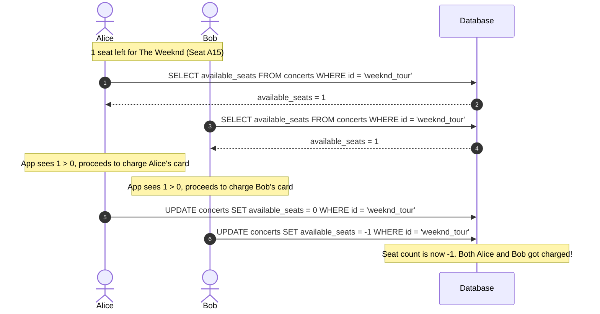
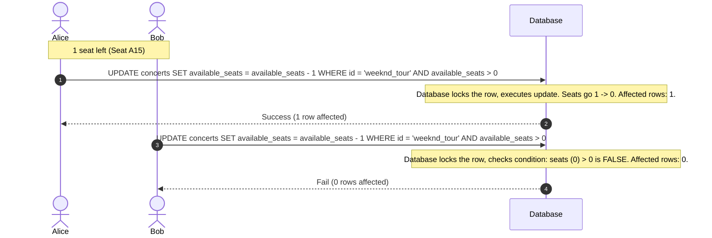
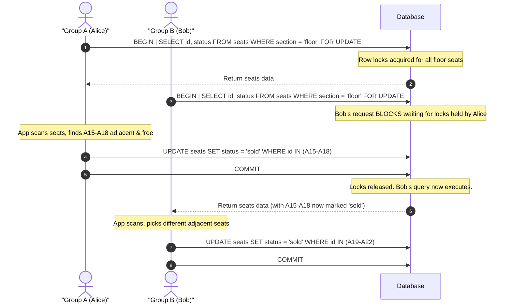
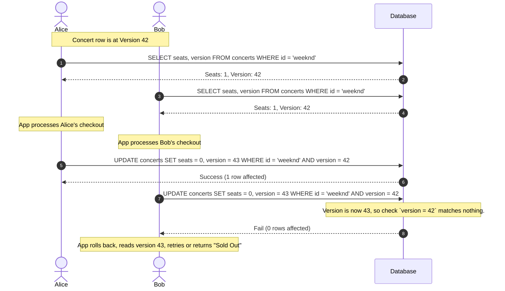
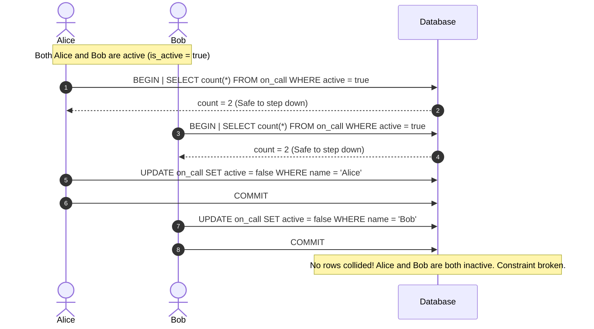
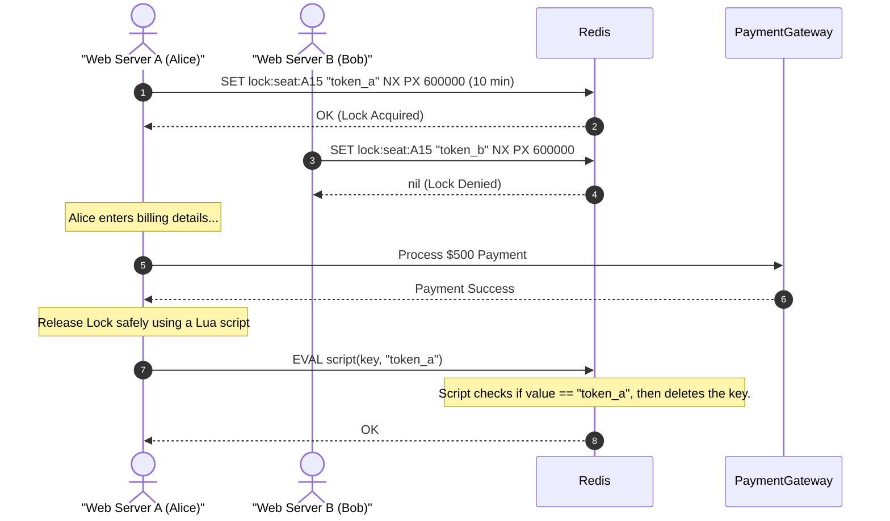
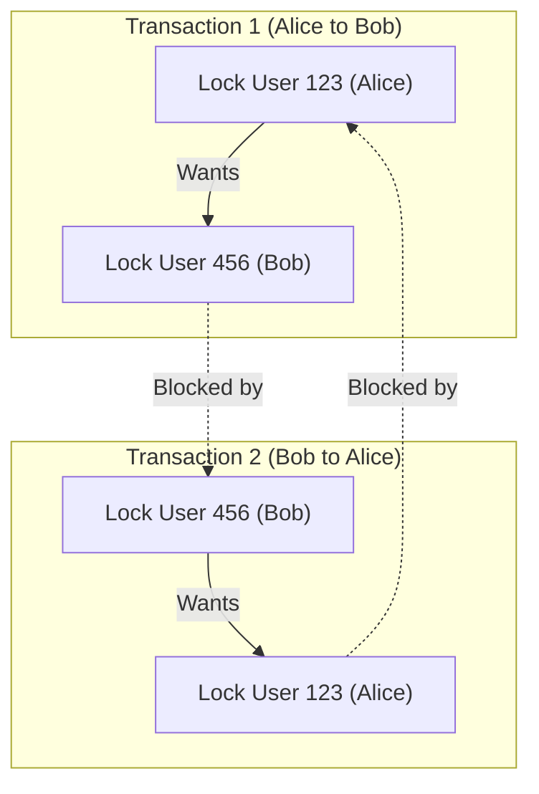
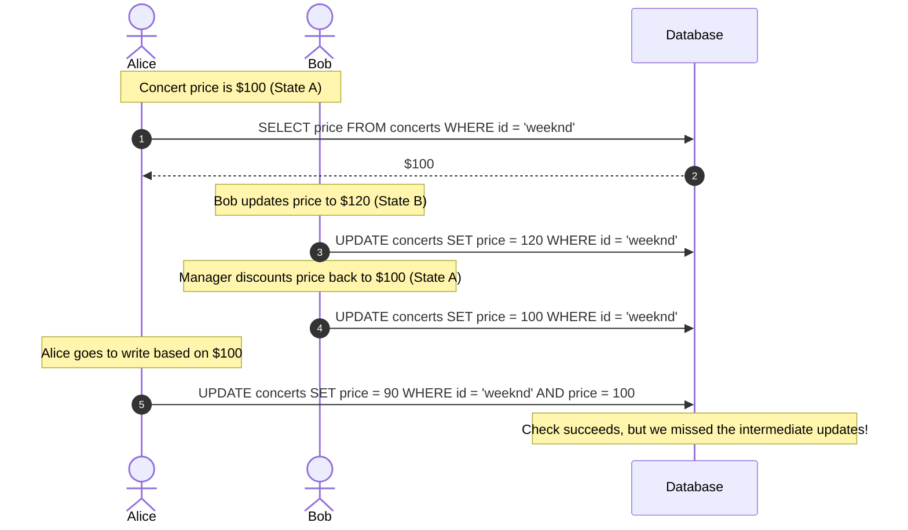
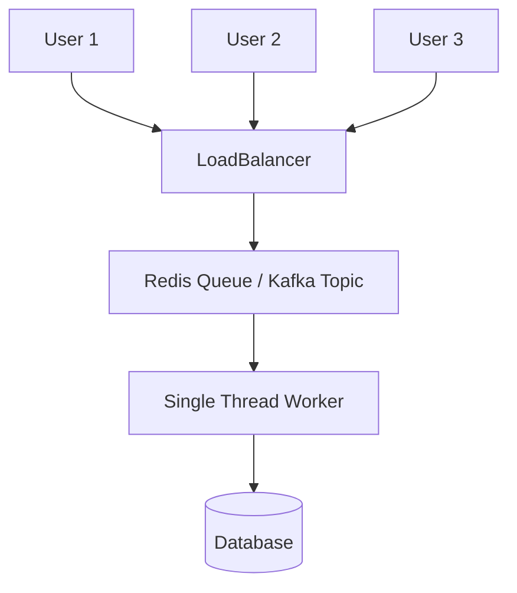

# Concurrency Control & Contention Patterns Guide

This guide breaks down the core concepts of handling data contention and race conditions in concurrent systems. Each concept is explained with concrete code examples (SQL & Node.js/JavaScript), visual flows, and the engineering rationale for transitioning from one rung to the next.

---

## 1. The Race Condition & Lost Update (The Naive Approach)

### The Concept
A **lost update** occurs in a read-modify-write cycle when two concurrent clients read the same initial state, make decisions based on it, and then write back their updates. The last write silently overwrites the previous write without incorporating its changes.

### The Naive Flow (Vulnerable)


### Naive JavaScript Implementation
```javascript
// VULNERABLE CODE - DO NOT USE IN PRODUCTION
async function purchaseTicketNaive(userId, concertId) {
  // Step 1: Read current count
  const [concert] = await db.query(
    "SELECT available_seats FROM concerts WHERE concert_id = ?", 
    [concertId]
  );
  
  if (concert.available_seats <= 0) {
    throw new Error("Sold out!");
  }
  
  // Step 2: Simulate network lag / payment processing
  await chargeCard(userId, 500); 

  // Step 3: Write back decremented count
  const newSeats = concert.available_seats - 1;
  await db.query(
    "UPDATE concerts SET available_seats = ? WHERE concert_id = ?",
    [newSeats, concertId]
  );
  
  // Step 4: Record the ticket
  await db.query(
    "INSERT INTO tickets (user_id, concert_id) VALUES (?, ?)",
    [userId, concertId]
  );
}
```

---

## 2. Conditional Writes (Atomic CAS)

### The Problem Before This Concept
In the naive approach, reading the state into the application memory and writing it back are two distinct statements. This creates a **time-of-check to time-of-use (TOCTOU)** gap. During this gap, another thread can step in, read the same stale value, and perform a conflicting write.

### Why We Use This Approach
Instead of pulling the check into our application, we push the condition directly into the database write using a `WHERE` predicate. The database locks the target row, evaluates the condition, and performs the write in a single atomic step. If the condition is no longer met, the query matches 0 rows and fails safely. This is the **most performant, zero-overhead** synchronization mechanism.

### The Flow


### SQL Transaction (Inserting Ticket Safely)
To link the counter update and the ticket insertion atomically, we can use a Common Table Expression (CTE) to make the `INSERT` depend directly on whether the `UPDATE` succeeded.

```sql
BEGIN TRANSACTION;

WITH reservation AS (
  UPDATE concerts
  SET available_seats = available_seats - 1
  WHERE concert_id = 'weeknd_tour'
    AND available_seats > 0
  RETURNING concert_id
)
INSERT INTO tickets (user_id, concert_id, seat_number, purchase_time)
SELECT 'user_alice', concert_id, 'A15', NOW()
FROM reservation;

COMMIT;
```

### Node.js Implementation (Gated on Affected Rows)
```javascript
async function purchaseTicketConditional(userId, concertId, seatNumber) {
  const connection = await db.getConnection();
  await connection.beginTransaction();
  
  try {
    // 1. Single atomic update guarding the seats check
    const [result] = await connection.query(
      `UPDATE tickets 
       SET status = 'sold', user_id = ? 
       WHERE concert_id = ? AND seat_number = ? AND status = 'available'`,
      [userId, concertId, seatNumber]
    );

    // 2. If 0 rows were affected, someone else got the seat first
    if (result.affectedRows === 0) {
      await connection.rollback();
      throw new Error("Seat already taken!");
    }

    await connection.commit();
    return { success: true };
  } catch (error) {
    await connection.rollback();
    throw error;
  } finally {
    connection.release();
  }
}
```

### The Limitation / Failure Mode
Conditional writes only work when the validation rule can be written as a simple SQL `WHERE` clause on the exact row being updated. It cannot handle cases where the check requires complex calculations in application code (e.g. searching a grid for adjacent seats) or spans multiple separate tables.

---

## 3. Pessimistic Locking

### The Problem Before This Concept
When the check logic is complex (such as reading a whole seating map to find 4 adjacent seats), it cannot be written as a single `WHERE` predicate. The application must read multiple rows, execute search logic in application memory, and then issue updates. In the gap between reading the seating map and reserving the seats, other users can claim those same seats.

### Why We Use This Approach
We explicitly tell the database to lock the rows during the read stage using `SELECT ... FOR UPDATE`. This blocks other concurrent transactions from reading, locking, or modifying these rows until we release the lock (by committing or rolling back). This freezes the state of the data in the database while our application runs arbitrary complex logic in memory.

> [!NOTE]
> **What do we mean by "other transactions"?**
> When a user makes a request (e.g., hits "Buy Now"), our web server opens a connection to the database and starts a database transaction. If 100 users hit the server concurrently, the database opens 100 concurrent transactions. 
> Without `FOR UPDATE`, all 100 transactions read the exact same data simultaneously. With pessimistic locking, the first transaction to execute the query acquires locks on those rows; the remaining 99 transactions are forced to queue up and wait at the database level until the first transaction commits its work and releases the locks.

### The Flow


### Node.js Implementation
```javascript
async function bookAdjacentSeatsPessimistic(userId, concertId, requestedCount) {
  const connection = await db.getConnection();
  await connection.beginTransaction();

  try {
    // 1. Acquire row-level locks on all available seats in this concert
    const [seats] = await connection.query(
      `SELECT seat_number, row_number, status 
       FROM seats 
       WHERE concert_id = ? AND status = 'available' 
       FOR UPDATE`,
      [concertId]
    );

    // 2. Complex application logic: Find adjacent seats in the locked set
    const selectedSeats = findAdjacentSeats(seats, requestedCount); // custom helper
    if (selectedSeats.length < requestedCount) {
      throw new Error("No adjacent seats available");
    }

    const seatNumbers = selectedSeats.map(s => s.seat_number);

    // 3. Perform the write
    await connection.query(
      `UPDATE seats 
       SET status = 'sold', user_id = ? 
       WHERE concert_id = ? AND seat_number IN (?)`,
      [userId, concertId, seatNumbers]
    );

    await connection.commit();
  } catch (error) {
    await connection.rollback();
    throw error;
  } finally {
    connection.release();
  }
}
```

### The Limitation / Failure Mode
Pessimistic locking forces other database transactions (initiated by concurrent user requests attempting to access the same locked rows) to queue and block-wait in the database. Under heavy traffic, this serializes access, dramatically increasing request latency and bottlenecking database throughput. 

Furthermore, you **cannot hold a database lock open across external I/O** (such as waiting for a third-party Stripe payment call) or user actions (holding a seat during checkout) because keeping transaction connections open this long will quickly exhaust the database's connection pool.

---

## 4. Optimistic Concurrency Control (OCC)

### The Problem Before This Concept
Pessimistic locking acts defensively by assuming collisions will always happen, blocking other buyers eagerly. If actual collisions are rare (e.g. 1,000 seats and only 10 concurrent buyers), we pay a high performance penalty in blocking overhead, connection pool usage, and latency for no reason.

### Why We Use This Approach
OCC operates on the assumption that conflicts are rare. We let transactions run concurrently without acquiring database-level locks. We read the row along with a `version` identifier. When writing, we check if the version is still what we read:
`WHERE version = expected_version`
If another transaction updated the row in the meantime, the version check fails, our write updates 0 rows, and our application simply rolls back and retries. This maximizes concurrent throughput by avoiding locking overhead entirely.

### The Flow


### Node.js Implementation with Retries
```javascript
async function purchaseTicketOCC(userId, concertId) {
  const maxRetries = 3;
  let attempt = 0;

  while (attempt < maxRetries) {
    attempt++;
    const [concert] = await db.query(
      "SELECT available_seats, version FROM concerts WHERE concert_id = ?",
      [concertId]
    );

    if (concert.available_seats <= 0) {
      throw new Error("Sold out!");
    }

    const connection = await db.getConnection();
    await connection.beginTransaction();

    try {
      // Perform the update conditional on the version we read
      const [result] = await connection.query(
        `UPDATE concerts 
         SET available_seats = available_seats - 1, version = version + 1 
         WHERE concert_id = ? AND version = ?`,
        [concertId, concert.version]
      );

      if (result.affectedRows === 1) {
        // Insert the ticket
        await connection.query(
          "INSERT INTO tickets (user_id, concert_id) VALUES (?, ?)",
          [userId, concertId]
        );
        await connection.commit();
        return { success: true };
      }

      // If affectedRows is 0, someone modified the row. Rollback and retry.
      await connection.rollback();
      console.warn(`Concurrency conflict on attempt ${attempt}. Retrying...`);
    } catch (error) {
      await connection.rollback();
      throw error;
    } finally {
      connection.release();
    }
  }
  
  throw new Error("Failed to purchase ticket after maximum retries due to high contention.");
}
```

### The Limitation / Failure Mode
If contention suddenly increases (e.g. Taylor Swift tickets drop), OCC degrades rapidly. The system enters a **retry storm** where many database connections repeatedly fail, roll back, and retry, consuming CPU and database cycles without completing any work. 

Additionally, OCC does not catch **write skew**—an anomaly where two concurrent transactions read overlapping rows, but write to *different* rows, leaving the row-level version checks blind.

---

## 5. Isolation Levels & Write Skew

### The Problem Before This Concept
OCC, conditional writes, and row locks only protect against conflicts where multiple transactions attempt to modify the **same** row. 

If two transactions read overlapping data sets but write to **different** rows, they will not collide, meaning their version columns and row locks remain entirely unaffected. However, the logical constraint combining these rows can still be broken.

> [!IMPORTANT]
> **Step-by-Step Example of Write Skew OCC Blindness**
> Consider an on-call schedule table `on_call` where at least 1 engineer must remain active. Alice and Bob are currently on call:
> 
> | engineer_id | is_active | version |
> | :--- | :--- | :--- |
> | alice | true | 1 |
> | bob | true | 1 |
> 
> Alice and Bob attempt to step down at the exact same moment:
> 1. **Alice's Transaction (Tx 1)**:
>    - Reads all active rows: sees Alice (version 1) and Bob (version 1). Active count = 2.
>    - Concludes active count (2) > 1, so it is safe to step down.
>    - Prepares to write: `UPDATE on_call SET is_active = false, version = version + 1 WHERE engineer_id = 'alice' AND version = 1`.
> 2. **Bob's Transaction (Tx 2)**:
>    - Reads active rows concurrently: sees Alice (version 1) and Bob (version 1). Active count = 2.
>    - Concludes active count (2) > 1, so it is safe to step down.
>    - Prepares to write: `UPDATE on_call SET is_active = false, version = version + 1 WHERE engineer_id = 'bob' AND version = 1`.
> 3. **Execution**:
>    - **Tx 1 executes**: Updates Alice's row. Alice's version is 1. The write succeeds (version bumped to 2). Tx 1 commits.
>    - **Tx 2 executes**: Updates Bob's row. Bob's version in the database is still 1 (unaffected by Alice's write since Alice updated a different row). The write succeeds (version bumped to 2). Tx 2 commits.
> 4. **Final State**:
>    - Both Alice and Bob are inactive (`is_active = false`). Active count is 0. System constraint violated!
>    - **Why OCC was blind**: Alice's write checked only Alice's version column. Bob's write checked only Bob's version column. Neither transaction updated a row that the other transaction *modified*, so their version checks did not detect any conflict.

### Why We Use This Approach
To enforce invariants that span multiple rows, we either elevate the transaction's isolation level to `SERIALIZABLE` or "materialize the conflict" by locking a shared parent row (e.g. locking the `team` row). 

Under `SERIALIZABLE`, the database tracks read-write dependencies. If it detects that Alice's transaction committed a write to a row that Bob's transaction read to make its decision, the database aborts Bob's transaction with a serialization error, forcing Bob's application to retry.

### The Flow


### The Solutions

#### Solution A: SERIALIZABLE Isolation Level
```javascript
async function stepDownSerializable(engineerId) {
  const connection = await db.getConnection();
  
  // Set isolation level to serializable for Postgres/MySQL
  await connection.query("SET TRANSACTION ISOLATION LEVEL SERIALIZABLE");
  await connection.beginTransaction();

  try {
    const [onCallCount] = await connection.query(
      "SELECT count(*) as count FROM on_call WHERE is_active = true"
    );

    if (onCallCount[0].count <= 1) {
      throw new Error("Cannot step down. At least one engineer must be active.");
    }

    await connection.query(
      "UPDATE on_call SET is_active = false WHERE engineer_id = ?",
      [engineerId]
    );

    await connection.commit();
  } catch (error) {
    await connection.rollback();
    // Catch standard serialization failure code (e.g., '40001' in Postgres)
    if (error.code === '40001') {
      // Application should retry the operation
      return stepDownSerializable(engineerId); 
    }
    throw error;
  } finally {
    connection.release();
  }
}
```

#### Solution B: Materializing conflicts (Simulated on-call row lock)
```sql
BEGIN TRANSACTION;

-- Lock the parent 'team' row. Any other engineer stepping down on this team blocks here.
SELECT * FROM teams WHERE team_id = 'payments' FOR UPDATE;

-- Safe to count now
SELECT count(*) FROM on_call WHERE team_id = 'payments' AND is_active = true;

-- Update Alice's row
UPDATE on_call SET is_active = false WHERE engineer_id = 'alice';

COMMIT;
```

### The Limitation / Failure Mode
`SERIALIZABLE` transactions carry massive overhead because the database must maintain a complex dependency graph in memory. Furthermore, they are limited to a single relational database—they cannot coordinate actions across microservices, distinct databases, or external network boundaries.

> [!CAUTION]
> **Example of Serializable boundary failure (API double-charge)**
> Suppose you have a payment transaction running in `SERIALIZABLE` mode:
> 1. **Transaction starts**: Begins in `SERIALIZABLE` mode.
> 2. **Read**: Application reads user details and confirms the card hasn't been charged.
> 3. **External API Call**: Application invokes Stripe's API to process a $500 charge. Stripe charges the card successfully.
> 4. **Write**: Application updates the database to record the transaction.
> 5. **Commit**: At commit time, the database detects a write skew conflict (some other concurrent transaction updated user details). The database aborts the transaction and rolls back the database.
> 6. **Retry**: The application restarts the transaction. It reads the details, sees no record of the charge (since the previous write was rolled back), calls Stripe *again*, and Stripe charges the card a *second time*.
> Because database transactions rollback database state, they have no control over external side effects like HTTP calls, leading to double-charging.

---

## 6. Distributed Locks

### The Problem Before This Concept
Database transaction locks (`FOR UPDATE` or `SERIALIZABLE`) cannot outlive the database transaction. If we need to protect a resource (like a seat reservation) while a user fills out billing info (taking 5-10 minutes) or while waiting for a slow external API (like a credit card charge via Stripe), we cannot keep a database transaction open. Doing so would exhaust the database connection pool in seconds and bring down the application.

### Why We Use This Approach
We externalize the lock as a temporary data record—a **lease**—stored in a fast, distributed coordinate system. The lease has an expiration time (Time to Live / TTL). Because the lock is held as data, it can span multiple HTTP requests, microservices, and API calls without consuming database connection handles.

Depending on your architecture, you can implement distributed locking in three primary ways:

#### Approach A: Redis Leases (In-Memory Key-Value)
* **Mechanism**: Uses an atomic command like `SET lock_key unique_token NX PX 600000` to register the lease in Redis.
* **Why use it**: Extremely low latency (sub-millisecond) and built-in automatic lease expiration (TTL). Excellent for user-facing actions like holding a shopping cart or seat.
* **Limitations**: Not 100% consistent during network splits or Redis leader failures.

#### Approach B: Database Columns (SQL Leases)
* **Mechanism**: Store the lease directly in the database using a dedicated table or columns (`reserved_by` and `reserved_until` expiry timestamp) on the target row:
  ```sql
  UPDATE seats 
  SET reserved_by = 'user_123', reserved_until = NOW() + INTERVAL '10 minutes'
  WHERE seat_id = 'A15' AND (reserved_until IS NULL OR reserved_until < NOW());
  ```
* **Why use it**: Requires zero new infrastructure (e.g. no Redis cluster) and guarantees transactional consistency with the rest of your application data.
* **Limitations**: Database writes are slower, and frequent lock writes can cause DB lock contention under heavy load.

#### Approach C: Queue-Based Exclusive Ownership (Kafka Partitions)
* **Mechanism**: Route all commands for a specific resource ID (e.g., `seat_id`) to a message queue partition where the partition key is the resource ID. Because Apache Kafka assigns each partition to exactly one consumer thread at a time, that consumer processes requests sequentially.
* **Why use it**: Eliminates locking entirely by turning concurrent contention into sequential processing. Highly resilient and suited for event-driven systems (e.g., order processing).
* **Limitations**: Introduces asynchronous handling; web servers must wait for consumer responses via WebSockets or polling.

---

### Redis-Based Lease Flow


### The Slow Process Bug (Why Unique Tokens are Critical)
Releasing a lock must check that the key still contains your unique token. This prevents the "slow process" bug where a process finishes after its TTL expired and deletes a lock now held by someone else.

> [!WARNING]
> **Example of the Slow Process Bug**
> Consider this timeline where Server A inadvertently deletes Server B's lock:
> 
> | Time | Server A | Redis State | Server B |
> | :--- | :--- | :--- | :--- |
> | **0s** | Requests lock with TTL=10s, token="token_a". Succeeds. | `lock:seat:A15` = `"token_a"` (expires in 10s) | Idle |
> | **1s** | Enters GC Pause (Process frozen). | `lock:seat:A15` = `"token_a"` | Idle |
> | **10s** | Frozen. | **Lock Expires** (Redis deletes key). | Idle |
> | **10.5s** | Frozen. | `lock:seat:A15` = `"token_b"` (expires in 10s) | Requests lock with TTL=10s, token="token_b". **Succeeds!** |
> | **11s** | **GC Pause Ends**. Server A wakes up, thinks it still has the lock, and writes to database. | `lock:seat:A15` = `"token_b"` | Processing checkout. |
> | **11.5s** | Sends standard `DEL lock:seat:A15` command to release lock. | **Lock is Deleted!** (Redis removes Server B's lock). | Processing checkout. |
> | **12s** | Done. | Key is empty. | Server C requests lock, **succeeds**, and starts processing concurrently with Server B! |
> 
> * **The Fix**: The Lua script checks that the token is `"token_a"` before deleting. At **11.5s**, Server A's script checks the key, sees `"token_b"`, matches nothing, and returns `0` without deleting it. Server B's lock remains safe.

### Safe Release Lua Script (Redis)
```lua
-- KEYS[1] = lock key
-- ARGV[1] = unique token
if redis.call("get", KEYS[1]) == ARGV[1] then
    return redis.call("del", KEYS[1])
else
    return 0
end
```

### Code Implementations for Each Approach

#### Approach A: Redis Node.js Implementation
```javascript
import Redis from "ioredis";
import { v4 as uuidv4 } from "uuid";

const redis = new Redis();

async function bookSeatRedisLease(userId, seatId) {
  const lockKey = `lock:seat:${seatId}`;
  const token = uuidv4();
  const ttl = 600000; // 10 minutes in ms

  // 1. Attempt to acquire the lease (SET NX PX)
  const acquired = await redis.set(lockKey, token, "PX", ttl, "NX");
  
  if (!acquired) {
    throw new Error("Seat is temporarily reserved by another user. Try again later.");
  }

  try {
    // 2. Perform external action (e.g., Stripe API payment)
    await chargeCardWithGateway(userId, 500);

    // 3. Persist the booking in the main DB
    await db.query(
      "UPDATE seats SET status = 'sold', user_id = ? WHERE seat_id = ?",
      [userId, seatId]
    );

  } finally {
    // 4. Release the lock safely using Lua script to prevent the slow-process bug
    const releaseScript = `
      if redis.call("get", KEYS[1]) == ARGV[1] then
        return redis.call("del", KEYS[1])
      else
        return 0
      end
    `;
    await redis.eval(releaseScript, 1, lockKey, token);
  }
}
```

#### Approach B: Database Columns SQL Lease Implementation
```javascript
// Database-based Distributed Lease (No additional cache infrastructure required)
async function bookSeatDBLease(userId, seatId) {
  const leaseDurationMinutes = 10;
  
  // 1. Attempt to acquire the lease.
  // We atomically set reserved_by and reserved_until only if:
  // - The seat is not reserved (reserved_until IS NULL) OR
  // - The existing reservation has expired (reserved_until < NOW())
  const [result] = await db.query(
    `UPDATE seats 
     SET reserved_by = ?, 
         reserved_until = NOW() + INTERVAL ? MINUTE 
     WHERE seat_id = ? 
       AND (reserved_until IS NULL OR reserved_until < NOW()) 
       AND status = 'available'`,
    [userId, leaseDurationMinutes, seatId]
  );

  // If 0 rows were updated, the seat is locked or sold
  if (result.affectedRows === 0) {
    throw new Error("Seat is currently reserved or already booked.");
  }

  try {
    // 2. Perform external operations (e.g., Stripe Payment Call)
    await chargeCardWithGateway(userId, 500);

    // 3. Persist the booking by updating status and clearing reservation fields
    await db.query(
      `UPDATE seats 
       SET status = 'sold', 
           user_id = ?, 
           reserved_by = NULL, 
           reserved_until = NULL 
       WHERE seat_id = ? AND reserved_by = ?`,
      [userId, seatId, userId]
    );

  } catch (error) {
    // 4. On failure, release the lease immediately so other users don't wait for TTL
    await db.query(
      `UPDATE seats 
       SET reserved_by = NULL, 
           reserved_until = NULL 
       WHERE seat_id = ? AND reserved_by = ?`,
      [seatId, userId]
    );
    throw error;
  }
}
```

#### Approach C: Queue-Based Exclusive Ownership (Apache Kafka) Implementation
```javascript
import Kafka from "@confluentinc/kafka-javascript";

// 1. Producer: Routes reservations by resource key (seatId)
async function sendBookingRequest(producer, userId, seatId) {
  const topic = "booking-requests";
  const payload = Buffer.from(JSON.stringify({ userId, seatId }));
  
  // Passing -1 partition routes via the default partitioner (hashing key).
  // All messages for the same seatId end up in the exact same partition.
  producer.produce(topic, -1, payload, seatId);
}

// 2. Consumer: Single-threaded worker processing sequentially for assigned partitions
async function runBookingConsumer() {
  const config = {
    "bootstrap.servers": "localhost:9092",
    "group.id": "booking-processor",
  };

  const consumer = new Kafka.KafkaConsumer(config, {
    "auto.offset.reset": "earliest",
  });

  await new Promise((resolve) => {
    consumer.on("ready", () => resolve(consumer));
    consumer.connect();
  });

  consumer.subscribe(["booking-requests"]);
  consumer.consume();

  consumer.on("data", async (message) => {
    const seatId = message.key.toString(); // Partition key (e.g. 'A15')
    const { userId } = JSON.parse(message.value.toString());

    // Because Kafka routes all messages for 'seatId' to the SAME partition,
    // and a partition is assigned to exactly ONE consumer thread,
    // we process all reservations for this seat sequentially. No locking required!
    try {
      const [seat] = await db.query(
        "SELECT status FROM seats WHERE seat_id = ?",
        [seatId]
      );

      if (seat && seat.status === "available") {
        // Charge credit card
        await chargeCardWithGateway(userId, 500);

        // Update database
        await db.query(
          "UPDATE seats SET status = 'sold', user_id = ? WHERE seat_id = ?",
          [userId, seatId]
        );
        console.log(`Successfully booked seat ${seatId} for ${userId}`);
      } else {
        console.warn(`Booking failed for seat ${seatId}: Already reserved or sold.`);
      }
    } catch (err) {
      console.error(`Failed processing booking request for seat ${seatId}:`, err);
    }
  });
}
```

---

## 7. Common Deep Dives

### Deep Dive A: Deadlocks & Ordered Locking
When two concurrent operations acquire locks on the same set of rows in a different order, they block each other indefinitely.



#### The Solution: Ordered Locking
Before acquiring any locks, sort the keys/IDs deterministically.

```javascript
async function transferFunds(fromUserId, toUserId, amount) {
  // Sort user IDs to enforce a globally consistent lock acquisition order
  const [firstId, secondId] = [fromUserId, toUserId].sort((a, b) => a - b);

  const connection = await db.getConnection();
  await connection.beginTransaction();

  try {
    // Lock the first resource in order
    await connection.query("SELECT * FROM accounts WHERE id = ? FOR UPDATE", [firstId]);
    // Lock the second resource in order
    await connection.query("SELECT * FROM accounts WHERE id = ? FOR UPDATE", [secondId]);

    // Perform balance updates...
    await connection.query("UPDATE accounts SET balance = balance - ? WHERE id = ?", [amount, fromUserId]);
    await connection.query("UPDATE accounts SET balance = balance + ? WHERE id = ?", [amount, toUserId]);

    await connection.commit();
  } catch (error) {
    await connection.rollback();
    throw error;
  } finally {
    connection.release();
  }
}
```

---

### Deep Dive B: The ABA Problem in OCC
If your OCC check is based on a business value (like `seats` count or `price`) rather than a dedicated `version` column, the state can change from A to B and back to A without the OCC statement noticing.


* **Solution**: Always use a dedicated `version` integer column that increments monotonically: `version = version + 1`.

---

### Deep Dive C: Hot Partitions & Queue-Based Serialization
If millions of users compete for a single celebrity's resource or ticket release, locks and OCC retries will exhaust database connection pools and crash the app.



Instead of letting thousands of requests contend inside the database, you can serialize them:
1. Push incoming purchases into a Queue (like Redis or Apache Kafka).
2. A single thread consumer pulls transactions one-by-one from the queue.
3. Because the queue consumer is single-threaded, contention is 0. The worker makes simple, sequentially execution changes to the database.
4. Response is sent asynchronously to the user via WebSockets or polling.

---

## 8. Summary Decision Matrix

| Pattern | Use Case | Latency | Complexity | Key Risk / Failure Mode |
| :--- | :--- | :--- | :--- | :--- |
| **Conditional Write** | Simple check on the row being updated | Very Low | Low | DB isolation must handle condition check; limited to single-row SQL WHERE checks |
| **Pessimistic Locking** | Complex logic; High contention | Low (blocking) | Low | Deadlocks; calling third-party I/O inside lock blocks connection pools |
| **Optimistic Concurrency** | Read-decide-write; Low contention | Very Low | Medium | High CPU/Retry overhead under high contention (retry storms) |
| **Serializable Isolation** | Multi-row constraints (Write Skew) | Medium | Medium | Abort rate; Relational databases only; high performance overhead; cannot cross network boundaries |
| **Distributed Lock** | Locks spanning multiple steps / APIs | Medium | High | Lock expiry before task completion (GC pauses leading to split-brain) |
