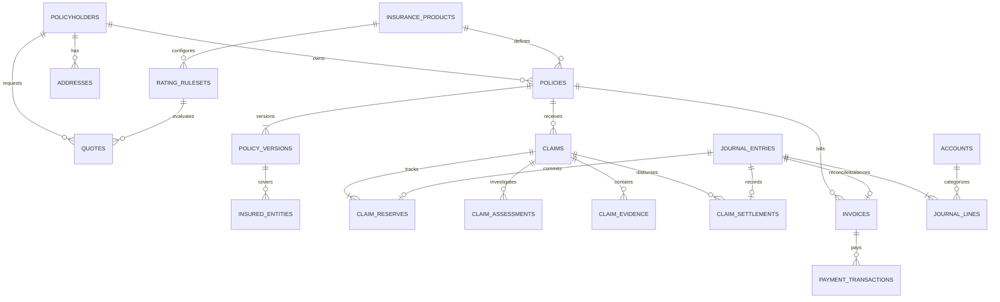

# Insurance Management System (IMS): Production Database Schema

---

## 1. Schema Architecture & Entity Relationship Diagram (ERD)

The IMS implements a modular, polyglot persistence design in **PostgreSQL**. Tables are isolated into logical schemas corresponding to bounded contexts, enforcing domain boundaries, strong transactional integrity, bi-temporal versioning, and strict double-entry ledger invariants.



### Visual Schema Topology (ASCII Map)

```
 [ party.policyholders ] ─── (1:N) ───► [ party.addresses ]
          │
          ├── (1:N) ───► [ rating.quotes ] ◄── (N:1) ─── [ rating.rating_rulesets ]
          │                                                       │ (N:1)
          │                                                       ▼
          │                                            [ rating.insurance_products ]
          │                                                       ▲
          ▼ (1:N)                                                 │ (N:1)
  [ policy.policies ] ────────────────────────────────────────────┘
          │
          ├── (1:N) ───► [ policy.policy_versions ] ─── (1:N) ───► [ policy.insured_entities ]
          │
          ├── (1:N) ───► [ billing.invoices ] ─── (1:N) ───► [ billing.payment_transactions ]
          │                     │                                         │
          │                     ▼ (1:1)                                   ▼ (1:1)
          │            [ billing.journal_entries ] ◄──────────────────────┘
          │                     │
          │                     ├── (1:N) ───► [ billing.journal_lines (Partitioned) ]
          │                     │                            ▲
          │                     ▼ (N:1)                      │ (N:1)
          │            [ billing.accounts ] ─────────────────┘
          │
          ▼ (1:N)
   [ claims.claims ]
          │
          ├── (1:N) ───► [ claims.claim_reserves ] ─── (N:1) ───► [ billing.journal_entries ]
          ├── (1:N) ───► [ claims.claim_assessments ]
          ├── (1:N) ───► [ claims.claim_evidence (S3 Objects) ]
          └── (1:N) ───► [ claims.claim_settlements ] ─── (N:1) ──► [ billing.journal_entries ]
```

---

## 2. DDL Specification by Bounded Context

```sql
-- Enable necessary cryptographic and UUID extensions
CREATE EXTENSION IF NOT EXISTS "pgcrypto";
CREATE EXTENSION IF NOT EXISTS "uuid-ossp";

-- Create isolated domain schemas
CREATE SCHEMA IF NOT EXISTS party;
CREATE SCHEMA IF NOT EXISTS rating;
CREATE SCHEMA IF NOT EXISTS policy;
CREATE SCHEMA IF NOT EXISTS billing;
CREATE SCHEMA IF NOT EXISTS claims;
CREATE SCHEMA IF NOT EXISTS system;
```

---

### 2.1 Party & Customer Management (`party` schema)

```sql
-- Core Policyholder / Insured Profile
CREATE TABLE party.policyholders (
    policyholder_id UUID PRIMARY KEY DEFAULT gen_random_uuid(),
    account_id VARCHAR(64) NOT NULL UNIQUE, -- Global consistent sharding key
    first_name VARCHAR(100) NOT NULL,
    last_name VARCHAR(100) NOT NULL,
    email VARCHAR(255) NOT NULL UNIQUE,
    phone VARCHAR(32) NOT NULL,
    date_of_birth DATE NOT NULL,
    tax_identifier_hash CHAR(64) NOT NULL, -- SHA-256 hash of SSN/EIN
    risk_tier VARCHAR(20) NOT NULL DEFAULT 'STANDARD' CHECK (risk_tier IN ('PREFERRED', 'STANDARD', 'NON_STANDARD', 'HIGH_RISK')),
    created_at TIMESTAMPTZ NOT NULL DEFAULT clock_timestamp(),
    updated_at TIMESTAMPTZ NOT NULL DEFAULT clock_timestamp()
);

CREATE INDEX idx_policyholders_email ON party.policyholders (email);
CREATE INDEX idx_policyholders_account ON party.policyholders (account_id);

-- Address & Risk Location Store
CREATE TABLE party.addresses (
    address_id UUID PRIMARY KEY DEFAULT gen_random_uuid(),
    policyholder_id UUID NOT NULL REFERENCES party.policyholders(policyholder_id) ON DELETE RESTRICT,
    address_type VARCHAR(20) NOT NULL CHECK (address_type IN ('MAILING', 'RESIDENTIAL', 'GARAGING', 'PROPERTY_LOCATION')),
    street_line1 VARCHAR(255) NOT NULL,
    street_line2 VARCHAR(255),
    city VARCHAR(100) NOT NULL,
    state VARCHAR(50) NOT NULL,
    postal_code VARCHAR(20) NOT NULL,
    country CHAR(2) NOT NULL DEFAULT 'US',
    latitude NUMERIC(9, 6),
    longitude NUMERIC(9, 6),
    flood_zone_risk_code VARCHAR(20) DEFAULT 'ZONE_X',
    is_primary BOOLEAN NOT NULL DEFAULT FALSE,
    created_at TIMESTAMPTZ NOT NULL DEFAULT clock_timestamp()
);

CREATE INDEX idx_addresses_policyholder ON party.addresses (policyholder_id);
CREATE INDEX idx_addresses_geo ON party.addresses (postal_code, state);
```

---

### 2.2 Product Catalog & Dynamic Rating (`rating` schema)

```sql
-- Master Product Catalog
CREATE TABLE rating.insurance_products (
    product_id UUID PRIMARY KEY DEFAULT gen_random_uuid(),
    product_code VARCHAR(50) NOT NULL UNIQUE, -- e.g., 'AUTO_PERSONAL_TIER1', 'HOME_HO3'
    line_of_business VARCHAR(30) NOT NULL CHECK (line_of_business IN ('AUTO', 'HOMEOWNERS', 'COMMERCIAL', 'LIFE', 'HEALTH')),
    product_name VARCHAR(150) NOT NULL,
    is_active BOOLEAN NOT NULL DEFAULT TRUE,
    created_at TIMESTAMPTZ NOT NULL DEFAULT clock_timestamp()
);

-- Versioned Actuarial Rating Rulesets & Multiplier Tables
CREATE TABLE rating.rating_rulesets (
    ruleset_id UUID PRIMARY KEY DEFAULT gen_random_uuid(),
    product_id UUID NOT NULL REFERENCES rating.insurance_products(product_id) ON DELETE RESTRICT,
    version_number INT NOT NULL,
    effective_from TIMESTAMPTZ NOT NULL,
    effective_to TIMESTAMPTZ NOT NULL,
    base_rate_cents BIGINT NOT NULL CHECK (base_rate_cents > 0),
    rules_definition_jsonb JSONB NOT NULL, -- Declarative formula & multiplier matrices
    status VARCHAR(20) NOT NULL DEFAULT 'ACTIVE' CHECK (status IN ('DRAFT', 'ACTIVE', 'SUPERSEDED')),
    created_at TIMESTAMPTZ NOT NULL DEFAULT clock_timestamp(),
    CONSTRAINT uq_product_ruleset_version UNIQUE (product_id, version_number)
);

CREATE INDEX idx_rulesets_lookup ON rating.rating_rulesets (product_id, effective_from, effective_to);

-- Dynamic Price Estimates & Bound Quotes
CREATE TABLE rating.quotes (
    quote_id UUID PRIMARY KEY DEFAULT gen_random_uuid(),
    quote_number VARCHAR(64) NOT NULL UNIQUE,
    policyholder_id UUID NOT NULL REFERENCES party.policyholders(policyholder_id) ON DELETE RESTRICT,
    product_id UUID NOT NULL REFERENCES rating.insurance_products(product_id) ON DELETE RESTRICT,
    ruleset_id UUID NOT NULL REFERENCES rating.rating_rulesets(ruleset_id) ON DELETE RESTRICT,
    quoted_annual_premium_cents BIGINT NOT NULL CHECK (quoted_annual_premium_cents > 0),
    deductible_cents BIGINT NOT NULL CHECK (deductible_cents >= 0),
    risk_assessment_payload JSONB NOT NULL, -- Vehicle/driver/property details evaluated
    status VARCHAR(20) NOT NULL DEFAULT 'QUOTED' CHECK (status IN ('DRAFT', 'QUOTED', 'BOUND', 'EXPIRED', 'REJECTED')),
    expires_at TIMESTAMPTZ NOT NULL,
    created_at TIMESTAMPTZ NOT NULL DEFAULT clock_timestamp()
);

CREATE INDEX idx_quotes_policyholder ON rating.quotes (policyholder_id);
CREATE INDEX idx_quotes_expiry ON rating.quotes (expires_at) WHERE status = 'QUOTED';
```

---

### 2.3 Policy Lifecycle & Bi-Temporal Contracts (`policy` schema)

```sql
-- Policy Aggregate Root
CREATE TABLE policy.policies (
    policy_id UUID PRIMARY KEY DEFAULT gen_random_uuid(),
    policy_number VARCHAR(64) NOT NULL UNIQUE,
    policyholder_id UUID NOT NULL REFERENCES party.policyholders(policyholder_id) ON DELETE RESTRICT,
    product_id UUID NOT NULL REFERENCES rating.insurance_products(product_id) ON DELETE RESTRICT,
    current_version_number INT NOT NULL DEFAULT 1,
    status VARCHAR(30) NOT NULL DEFAULT 'PENDING_PAYMENT' 
        CHECK (status IN ('PENDING_PAYMENT', 'ACTIVE', 'SUSPENDED', 'LAPSED', 'CANCELLED', 'EXPIRED')),
    term_start_date TIMESTAMPTZ NOT NULL,
    term_end_date TIMESTAMPTZ NOT NULL,
    cancellation_date TIMESTAMPTZ,
    cancellation_reason VARCHAR(100),
    created_at TIMESTAMPTZ NOT NULL DEFAULT clock_timestamp(),
    updated_at TIMESTAMPTZ NOT NULL DEFAULT clock_timestamp(),
    CONSTRAINT chk_term_period CHECK (term_end_date > term_start_date)
);

CREATE INDEX idx_policies_holder ON policy.policies (policyholder_id);
CREATE INDEX idx_policies_status ON policy.policies (status);

-- Bi-Temporal Policy Versions (Point-in-Time Coverage Reconstruction)
CREATE TABLE policy.policy_versions (
    version_id UUID PRIMARY KEY DEFAULT gen_random_uuid(),
    policy_id UUID NOT NULL REFERENCES policy.policies(policy_id) ON DELETE CASCADE,
    version_number INT NOT NULL,
    endorsement_type VARCHAR(50) NOT NULL DEFAULT 'NEW_BUSINESS'
        CHECK (endorsement_type IN ('NEW_BUSINESS', 'MID_TERM_ADJUSTMENT', 'RENEWAL', 'CANCELLATION', 'REINSTATEMENT')),
    valid_from TIMESTAMPTZ NOT NULL, -- Real-world coverage effective timestamp
    valid_to TIMESTAMPTZ NOT NULL,   -- Real-world coverage expiration timestamp
    transaction_time TIMESTAMPTZ NOT NULL DEFAULT clock_timestamp(), -- DB audit insertion timestamp
    annual_premium_cents BIGINT NOT NULL CHECK (annual_premium_cents >= 0),
    coverage_tree_jsonb JSONB NOT NULL, -- Detailed coverages, limits, deductibles, riders
    change_summary_jsonb JSONB, -- Diff against previous version
    CONSTRAINT uq_policy_version_seq UNIQUE (policy_id, version_number),
    CONSTRAINT chk_valid_window CHECK (valid_to >= valid_from)
);

CREATE INDEX idx_policy_versions_temporal ON policy.policy_versions (policy_id, valid_from, valid_to);

-- Specific Insured Risks Covered Under the Version (Vehicles, Homes, Persons)
CREATE TABLE policy.insured_entities (
    entity_id UUID PRIMARY KEY DEFAULT gen_random_uuid(),
    policy_id UUID NOT NULL REFERENCES policy.policies(policy_id) ON DELETE CASCADE,
    version_id UUID NOT NULL REFERENCES policy.policy_versions(version_id) ON DELETE CASCADE,
    entity_type VARCHAR(30) NOT NULL CHECK (entity_type IN ('VEHICLE', 'PROPERTY', 'INDIVIDUAL', 'COMMERCIAL_ASSET')),
    external_identifier VARCHAR(100) NOT NULL, -- VIN, Property Address ID, Driver License / SSN Hash
    attributes_payload JSONB NOT NULL, -- Make, Model, Mileage, Year, Construction Type
    created_at TIMESTAMPTZ NOT NULL DEFAULT clock_timestamp()
);

CREATE INDEX idx_insured_entities_lookup ON policy.insured_entities (policy_id, external_identifier);
```

---

### 2.4 Double-Entry General Ledger & Invoicing (`billing` schema)

```sql
-- Chart of Accounts
CREATE TABLE billing.accounts (
    account_id UUID PRIMARY KEY DEFAULT gen_random_uuid(),
    account_code VARCHAR(30) NOT NULL UNIQUE, -- e.g., '1010-CASH', '1200-AR-PREMIUM', '2200-UNEARNED-PREMIUM', '2100-LOSS-RESERVES', '5010-CLAIM-LOSS-EXPENSE'
    account_name VARCHAR(100) NOT NULL,
    account_type VARCHAR(20) NOT NULL CHECK (account_type IN ('ASSET', 'LIABILITY', 'EQUITY', 'REVENUE', 'EXPENSE')),
    currency CHAR(3) NOT NULL DEFAULT 'USD',
    is_active BOOLEAN NOT NULL DEFAULT TRUE,
    created_at TIMESTAMPTZ NOT NULL DEFAULT clock_timestamp()
);

-- Atomic Journal Transactions
CREATE TABLE billing.journal_entries (
    entry_id UUID PRIMARY KEY DEFAULT gen_random_uuid(),
    transaction_type VARCHAR(50) NOT NULL 
        CHECK (transaction_type IN ('PREMIUM_INVOICED', 'PAYMENT_CAPTURED', 'EARNED_PREMIUM_RECOGNITION', 'LOSS_RESERVE_ALLOCATED', 'CLAIM_PAYOUT_SETTLED', 'PREMIUM_REFUND_ISSUED')),
    idempotency_key VARCHAR(100) NOT NULL UNIQUE,
    reference_policy_id UUID REFERENCES policy.policies(policy_id),
    reference_claim_id UUID,
    description TEXT,
    created_at TIMESTAMPTZ NOT NULL DEFAULT clock_timestamp()
);

CREATE INDEX idx_journal_entries_policy ON billing.journal_entries (reference_policy_id);
CREATE INDEX idx_journal_entries_claim ON billing.journal_entries (reference_claim_id);

-- Partitioned Append-Only Journal Lines (Enforcing Debit/Credit Integrity)
CREATE TABLE billing.journal_lines (
    line_id UUID DEFAULT gen_random_uuid(),
    entry_id UUID NOT NULL REFERENCES billing.journal_entries(entry_id) ON DELETE RESTRICT,
    account_id UUID NOT NULL REFERENCES billing.accounts(account_id) ON DELETE RESTRICT,
    entry_type VARCHAR(10) NOT NULL CHECK (entry_type IN ('DEBIT', 'CREDIT')),
    amount_cents BIGINT NOT NULL CHECK (amount_cents > 0),
    created_at TIMESTAMPTZ NOT NULL DEFAULT clock_timestamp(),
    PRIMARY KEY (line_id, created_at)
) PARTITION BY RANGE (created_at);

-- Monthly partitions for performance and zero index bloat
CREATE TABLE billing.journal_lines_2026_08 PARTITION OF billing.journal_lines
    FOR VALUES FROM ('2026-08-01 00:00:00+00') TO ('2026-09-01 00:00:00+00');
CREATE TABLE billing.journal_lines_2026_09 PARTITION OF billing.journal_lines
    FOR VALUES FROM ('2026-09-01 00:00:00+00') TO ('2026-10-01 00:00:00+00');

CREATE INDEX idx_journal_lines_entry ON billing.journal_lines (entry_id);
CREATE INDEX idx_journal_lines_account ON billing.journal_lines (account_id);

-- Customer Invoices
CREATE TABLE billing.invoices (
    invoice_id UUID PRIMARY KEY DEFAULT gen_random_uuid(),
    invoice_number VARCHAR(64) NOT NULL UNIQUE,
    policy_id UUID NOT NULL REFERENCES policy.policies(policy_id) ON DELETE RESTRICT,
    billing_period_start TIMESTAMPTZ NOT NULL,
    billing_period_end TIMESTAMPTZ NOT NULL,
    due_date TIMESTAMPTZ NOT NULL,
    total_amount_cents BIGINT NOT NULL CHECK (total_amount_cents > 0),
    paid_amount_cents BIGINT NOT NULL DEFAULT 0 CHECK (paid_amount_cents >= 0),
    status VARCHAR(20) NOT NULL DEFAULT 'PENDING' CHECK (status IN ('PENDING', 'PAID', 'PARTIALLY_PAID', 'OVERDUE', 'CANCELLED')),
    created_at TIMESTAMPTZ NOT NULL DEFAULT clock_timestamp()
);

CREATE INDEX idx_invoices_policy ON billing.invoices (policy_id);
CREATE INDEX idx_invoices_due ON billing.invoices (due_date) WHERE status = 'PENDING';

-- Payment Gateway Transactions
CREATE TABLE billing.payment_transactions (
    transaction_id UUID PRIMARY KEY DEFAULT gen_random_uuid(),
    invoice_id UUID NOT NULL REFERENCES billing.invoices(invoice_id) ON DELETE RESTRICT,
    journal_entry_id UUID REFERENCES billing.journal_entries(entry_id),
    gateway_provider VARCHAR(50) NOT NULL, -- Stripe, Adyen, BACS, FedNow
    gateway_transaction_id VARCHAR(100) NOT NULL UNIQUE,
    amount_cents BIGINT NOT NULL CHECK (amount_cents > 0),
    currency CHAR(3) NOT NULL DEFAULT 'USD',
    payment_method VARCHAR(30) NOT NULL CHECK (payment_method IN ('CREDIT_CARD', 'ACH_DEBIT', 'WIRE_TRANSFER', 'DIGITAL_WALLET')),
    status VARCHAR(20) NOT NULL CHECK (status IN ('INITIATED', 'AUTHORIZED', 'CAPTURED', 'FAILED', 'REFUNDED')),
    failure_reason TEXT,
    created_at TIMESTAMPTZ NOT NULL DEFAULT clock_timestamp()
);

CREATE INDEX idx_payments_invoice ON billing.payment_transactions (invoice_id);
```

---

### 2.5 Claims Management & FNOL (`claims` schema)

```sql
-- Claims Dossier Aggregate Root
CREATE TABLE claims.claims (
    claim_id UUID PRIMARY KEY DEFAULT gen_random_uuid(),
    claim_number VARCHAR(64) NOT NULL UNIQUE,
    policy_id UUID NOT NULL REFERENCES policy.policies(policy_id) ON DELETE RESTRICT,
    policy_version_id UUID NOT NULL REFERENCES policy.policy_versions(version_id) ON DELETE RESTRICT,
    date_of_loss TIMESTAMPTZ NOT NULL,
    reported_at TIMESTAMPTZ NOT NULL DEFAULT clock_timestamp(),
    status VARCHAR(30) NOT NULL DEFAULT 'FILED'
        CHECK (status IN ('FILED', 'UNDER_INVESTIGATION', 'ADJUDICATED_APPROVED', 'ADJUDICATED_DENIED', 'SETTLED', 'CLOSED')),
    loss_cause VARCHAR(50) NOT NULL, -- COLLISION, THEFT, WATER_DAMAGE, WINDSTORM, FIRE, MEDICAL
    incident_description TEXT NOT NULL,
    incident_location_jsonb JSONB NOT NULL,
    assigned_adjuster_id UUID,
    denial_reason TEXT,
    created_at TIMESTAMPTZ NOT NULL DEFAULT clock_timestamp(),
    updated_at TIMESTAMPTZ NOT NULL DEFAULT clock_timestamp()
);

CREATE INDEX idx_claims_policy ON claims.claims (policy_id);
CREATE INDEX idx_claims_status ON claims.claims (status);
CREATE INDEX idx_claims_date_of_loss ON claims.claims (date_of_loss);

-- Claim Loss Reserves Tracking (Financial Liability)
CREATE TABLE claims.claim_reserves (
    reserve_id UUID PRIMARY KEY DEFAULT gen_random_uuid(),
    claim_id UUID NOT NULL REFERENCES claims.claims(claim_id) ON DELETE CASCADE,
    journal_entry_id UUID NOT NULL REFERENCES billing.journal_entries(entry_id) ON DELETE RESTRICT,
    reserve_type VARCHAR(30) NOT NULL CHECK (reserve_type IN ('INDEMNITY_LOSS', 'LEGAL_EXPENSE', 'MEDICAL_EXPENSE')),
    allocated_amount_cents BIGINT NOT NULL CHECK (allocated_amount_cents >= 0),
    revision_number INT NOT NULL DEFAULT 1,
    created_at TIMESTAMPTZ NOT NULL DEFAULT clock_timestamp()
);

CREATE INDEX idx_claim_reserves_claim ON claims.claim_reserves (claim_id);

-- Adjuster Appraisals & Investigation Records
CREATE TABLE claims.claim_assessments (
    assessment_id UUID PRIMARY KEY DEFAULT gen_random_uuid(),
    claim_id UUID NOT NULL REFERENCES claims.claims(claim_id) ON DELETE CASCADE,
    adjuster_id UUID NOT NULL,
    assessment_notes TEXT NOT NULL,
    total_estimated_damage_cents BIGINT NOT NULL CHECK (total_estimated_damage_cents >= 0),
    approved_settlement_cents BIGINT NOT NULL CHECK (approved_settlement_cents >= 0),
    is_fraud_flagged BOOLEAN NOT NULL DEFAULT FALSE,
    fraud_risk_score NUMERIC(5, 2) DEFAULT 0.0,
    adjudicated_at TIMESTAMPTZ NOT NULL DEFAULT clock_timestamp()
);

CREATE INDEX idx_claim_assessments_claim ON claims.claim_assessments (claim_id);

-- Claim Evidence Media Pointers (Stored in S3)
CREATE TABLE claims.claim_evidence (
    evidence_id UUID PRIMARY KEY DEFAULT gen_random_uuid(),
    claim_id UUID NOT NULL REFERENCES claims.claims(claim_id) ON DELETE CASCADE,
    s3_bucket VARCHAR(100) NOT NULL,
    s3_key VARCHAR(500) NOT NULL UNIQUE,
    file_name VARCHAR(255) NOT NULL,
    mime_type VARCHAR(100) NOT NULL,
    file_size_bytes BIGINT NOT NULL CHECK (file_size_bytes > 0),
    uploaded_by_persona VARCHAR(30) NOT NULL CHECK (uploaded_by_persona IN ('POLICYHOLDER', 'ADJUSTER', 'INSPECTOR', 'POLICE')),
    created_at TIMESTAMPTZ NOT NULL DEFAULT clock_timestamp()
);

CREATE INDEX idx_claim_evidence_claim ON claims.claim_evidence (claim_id);

-- Settlement Payout Disbursements
CREATE TABLE claims.claim_settlements (
    settlement_id UUID PRIMARY KEY DEFAULT gen_random_uuid(),
    claim_id UUID NOT NULL REFERENCES claims.claims(claim_id) ON DELETE RESTRICT,
    journal_entry_id UUID NOT NULL REFERENCES billing.journal_entries(entry_id) ON DELETE RESTRICT,
    payee_name VARCHAR(150) NOT NULL,
    payee_account_identifier VARCHAR(100) NOT NULL, -- Bank Account / Routing / Check Details
    disbursed_amount_cents BIGINT NOT NULL CHECK (disbursed_amount_cents > 0),
    disbursement_method VARCHAR(20) NOT NULL CHECK (disbursement_method IN ('DIRECT_DEPOSIT_ACH', 'FEDNOW_RTP', 'WIRE', 'CHECK')),
    payment_reference VARCHAR(100) NOT NULL UNIQUE,
    disbursed_at TIMESTAMPTZ NOT NULL DEFAULT clock_timestamp()
);

CREATE INDEX idx_claim_settlements_claim ON claims.claim_settlements (claim_id);
```

---

### 2.6 Transactional Outbox & Distributed Idempotency (`system` schema)

```sql
-- Transactional Outbox Table for Debezium CDC
CREATE TABLE system.outbox_events (
    event_id UUID PRIMARY KEY DEFAULT gen_random_uuid(),
    aggregate_type VARCHAR(50) NOT NULL, -- 'POLICY', 'CLAIM', 'BILLING', 'QUOTE'
    aggregate_id VARCHAR(64) NOT NULL,
    event_type VARCHAR(100) NOT NULL,    -- 'PolicyIssued', 'ClaimFiled', 'PaymentCaptured'
    event_payload JSONB NOT NULL,
    partition_key VARCHAR(64) NOT NULL,  -- Mapped to policy_id or account_id for Kafka partitioning
    created_at TIMESTAMPTZ NOT NULL DEFAULT clock_timestamp()
);

CREATE INDEX idx_outbox_created ON system.outbox_events (created_at);

-- Distributed Financial Idempotency Registry
CREATE TABLE system.idempotency_keys (
    idempotency_key VARCHAR(128) PRIMARY KEY,
    endpoint_path VARCHAR(255) NOT NULL,
    request_payload_hash CHAR(64) NOT NULL, -- SHA-256 hash of incoming JSON body
    status VARCHAR(20) NOT NULL DEFAULT 'PROCESSING' CHECK (status IN ('PROCESSING', 'COMPLETED', 'FAILED')),
    response_status_code INT,
    response_payload JSONB,
    created_at TIMESTAMPTZ NOT NULL DEFAULT clock_timestamp(),
    expires_at TIMESTAMPTZ NOT NULL
);

CREATE INDEX idx_idempotency_expiry ON system.idempotency_keys (expires_at);
```

---

## 3. Database Invariant Validation Trigger

To guarantee that no broken double-entry journal entry can ever be committed, we attach a `DEFERRABLE INITIALLY DEFERRED` constraint trigger on the ledger:

```sql
-- Stored procedure verifying balanced debits and credits across the journal entry
CREATE OR REPLACE FUNCTION billing.fn_verify_journal_entry_balance()
RETURNS TRIGGER AS $$
DECLARE
    v_debits BIGINT;
    v_credits BIGINT;
BEGIN
    SELECT 
        COALESCE(SUM(CASE WHEN entry_type = 'DEBIT' THEN amount_cents ELSE 0 END), 0),
        COALESCE(SUM(CASE WHEN entry_type = 'CREDIT' THEN amount_cents ELSE 0 END), 0)
    INTO v_debits, v_credits
    FROM billing.journal_lines
    WHERE entry_id = NEW.entry_id;

    IF v_debits <> v_credits THEN
        RAISE EXCEPTION 'Double-Entry Invariant Violation: Journal Entry % has mismatched Debits ($%) and Credits ($%)',
            NEW.entry_id, (v_debits::numeric / 100.0), (v_credits::numeric / 100.0);
    END IF;

    RETURN NEW;
END;
$$ LANGUAGE plpgsql;

CREATE OR REPLACE TRIGGER trg_verify_journal_balance
    AFTER INSERT OR UPDATE ON billing.journal_lines
    DEFERRABLE INITIALLY DEFERRED
    FOR EACH ROW
    EXECUTE FUNCTION billing.fn_verify_journal_entry_balance();
```

---

## 4. Key Performance Optimizations Applied

1. **Point-in-Time Temporal Range Indexing**: `idx_policy_versions_temporal` on `(policy_id, valid_from, valid_to)` enables $O(1)$ sub-millisecond coverage lookup for claims adjudication.
2. **Monthly Journal Partitioning**: Range-partitioned `billing.journal_lines` prevents B-tree write degradation and simplifies table vacuuming on high-volume financial accounting streams.
3. **Partial Indexes for Active Workloads**: `idx_invoices_due` on `(due_date) WHERE status = 'PENDING'` speeds up automated daily dunning and collection batch runs without scanning millions of historic paid invoices.
4. **Guaranteed Zero-Balance Ledger Trigger**: Uses `DEFERRABLE INITIALLY DEFERRED` so multi-line journal inserts can be staged in any order within an ACID transaction and validated atomically before commit.
