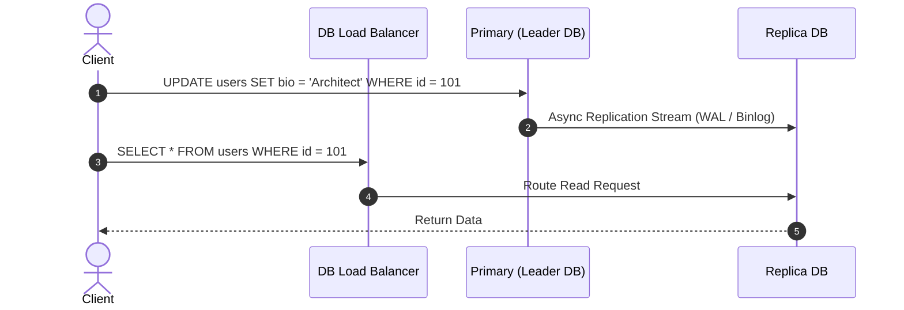
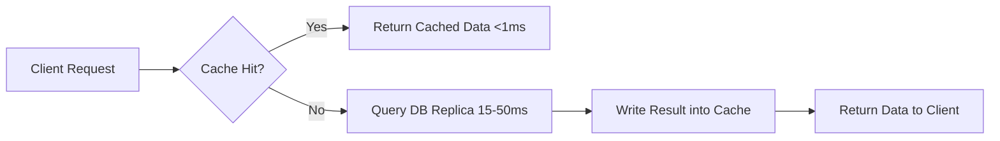

# Read Scaling Patterns in Distributed Systems: The Complete Engineering Guide

---

## 1. The Core Problem: Hardware Physics & Read/Write Asynchrony

### 🔴 The Problem

Consider an Instagram feed. When a user opens the application, the app immediately executes dozens of database queries to fetch photo metadata, user information, like counts, and comment previews. That's potentially **100+ read operations** just to load your feed. Meanwhile, that user might only post one photo per day—a single write operation.

```
[ Read:Write Asymmetry Spectrum ]

  1:1            10:1             100:1             1,000:1          100,000:1
───┼──────────────┼────────────────┼─────────────────┼────────────────┼───
Uber Location   Banking Ledger   E-Commerce      Twitter Feed     Bitly / YouTube
Tracking        Transactions     Product Pages   (Celebrity Post) (Viral Content)
```

As reads scale exponentially, systems hit physical hardware limits:

1. **CPU Core Limits**: CPU clock speeds are physically capped (~3.5–5.0 GHz). Query parsing, plan execution, and filtering consume scarce instruction cycles per second.
2. **Memory Bus Bandwidth**: DDR4/DDR5 RAM bandwidth (~25–50 GB/s per channel) limits how quickly data blocks can move into CPU caches during scans.
3. **Disk I/O Latency & IOPS Limits**: Random reads on spinning HDDs (~100–200 IOPS) or NVMe SSDs (~500,000 IOPS) saturate under high QPS.
4. **Network Interface Bandwidth**: Servicing 100,000 concurrent reads returning 10 KB payloads requires $100,000 \times 10 \text{ KB} = 1 \text{ GB/s}$ ($8 \text{ Gbps}$), saturating standard 10GbE NICs.

---

## 2. Stage 1: Optimize Within Your Database

---

### 2.1 B-Tree Indexing

#### 🔴 The Problem: $O(N)$ Full Table Scans

When querying un-indexed columns, the database performs a **Full Table Scan (Sequential Scan)**, reading every single row on disk. Scanning 10 million rows (200 bytes/row) reads **2 GB** of disk data per query, driving CPU to 100% and taking 400ms+ per query.

#### 🟢 The Solution

Add **B-Tree Indexes** to columns used in `WHERE`, `JOIN`, or `ORDER BY`. An index reduces an $O(N)$ full table scan to an $O(\log N)$ tree traversal (reading only 3 to 4 index pages, ~32 KB). Follow the **ESR Rule** for compound indexes:

1. **E**quality columns first.
2. **S**ort columns second.
3. **R**ange filter columns last.

#### 💻 Concrete Example (`EXPLAIN ANALYZE`)

```sql
-- ❌ UN-INDEXED QUERY (Full Table Scan: 410ms)
EXPLAIN ANALYZE SELECT * FROM users WHERE email = 'user_4059@example.com';
-- Output: Seq Scan on users (cost=0.00..215430.00 rows=1) (actual time=142.312..410.891 ms)

-- 🟢 ADD COMPOUND INDEX (ESR Rule)
CREATE INDEX idx_users_email ON users(email);

-- 🟢 INDEXED QUERY (B-Tree Index Scan: 0.045ms -> 9,000x faster!)
EXPLAIN ANALYZE SELECT * FROM users WHERE email = 'user_4059@example.com';
-- Output: Index Scan using idx_users_email (cost=0.43..8.45 rows=1) (actual time=0.042..0.045 ms)
```

---

### 2.2 Strategic Denormalization & Materialized Views

#### 🔴 The Problem: Expensive Multi-Table JOINs & Runtime Aggregations

In normalized schemas (3NF), displaying an order summary requires joining `users`, `orders`, `order_items`, and `products`. Combining millions of rows across 4 tables at runtime incurs high CPU and memory join penalties. Calculating aggregates (`AVG`, `SUM`) on every page load causes massive CPU spikes.

#### 🟢 The Solution

Trade extra disk storage to pre-duplicate fields into a single denormalized table or precompute aggregates into a **Materialized View**.

#### 💻 Concrete Example

```sql
-- ❌ NORMALIZED QUERY (4 JOINs on every read)
SELECT u.name, u.avatar_url, o.total_amount, p.title
FROM users u
JOIN orders o ON u.id = o.user_id
JOIN order_items oi ON o.id = oi.order_id
JOIN products p ON oi.product_id = p.id
WHERE u.id = 98765;

-- 🟢 DENORMALIZED SUMMARY TABLE (Single-table lookup)
CREATE TABLE user_order_summaries (
    order_id BIGINT PRIMARY KEY,
    user_id BIGINT NOT NULL,
    user_name VARCHAR(100),       -- Duplicated from users table
    items_json JSONB,             -- Pre-aggregated array of items
    total_amount DECIMAL(10,2)
);

-- Fast Single-Table Query
SELECT user_name, items_json FROM user_order_summaries WHERE user_id = 98765;

-- 🟢 MATERIALIZED VIEW FOR PRECOMPUTED AGGREGATES
CREATE MATERIALIZED VIEW mv_product_ratings AS
SELECT product_id, COUNT(id) AS total_reviews, ROUND(AVG(rating), 2) AS avg_rating
FROM reviews GROUP BY product_id;

-- Refresh asynchronously via background worker
REFRESH MATERIALIZED VIEW CONCURRENTLY mv_product_ratings;
```

---

## 3. Stage 2: Scale Your Database Horizontally

---

### 3.1 Read Replicas (Leader-Follower Architecture)

#### 🔴 The Problem: Single DB Connection & CPU Ceiling

A single database server has a physical limit (~50,000–100,000 QPS) bounded by CPU core count and memory bus limits. Throwing more application servers at one database exhausts connection pools.

#### 🟢 The Solution

Deploy **Leader-Follower Read Replicas**. All writes (`INSERT`, `UPDATE`, `DELETE`) go to the Primary (Leader) node. Read queries are load-balanced across multiple Secondary (Replica) nodes.



---

### 3.2 Handling Replication Lag (Read-Your-Own-Writes Consistency)

#### 🔴 The Problem: Replication Lag UX Bug

Replication from Primary to Replicas is asynchronous. A user updating their profile will immediately read from a lagging replica and see their old profile info ("UX bug").

```
Time 0ms: User updates bio to "Architect" ──► Primary DB (Success)
Time 5ms: User refreshes page             ──► Replica DB (Lag = 50ms)
Result:   User sees old bio ("Student")   ──► UX Bug!
```

#### 🟢 The Solution

1. **User Session Master-Stickiness**: Route all reads from a modifying user session to the Primary DB for a 5-second safety window after a write.
2. **GTID / Watermark Routing**: Check the replica's Global Transaction ID against the user's write transaction ID before serving.

#### 💻 Concrete Example

```typescript
async function getUserProfile(userId: string, userLastWriteGtid?: string) {
  if (userLastWriteGtid) {
    const replicaGtid = await replicaDb.getReplicationWatermark();

    if (replicaGtid < userLastWriteGtid) {
      // Replica is lagging behind user's last write; fallback to Primary Leader
      return await primaryDb.query("SELECT * FROM users WHERE id = ?", [
        userId,
      ]);
    }
  }
  // Replica is caught up; safe to serve from Replica
  return await replicaDb.query("SELECT * FROM users WHERE id = ?", [userId]);
}
```

---

### 3.3 Database Sharding

#### 🔴 The Problem: Monolithic Dataset Exceeds Node Storage

When total data volume exceeds single-server RAM/Disk limits, queries slow down even with indexes because index nodes no longer fit in memory.

#### 🟢 The Solution

Partition data across autonomous shard databases:

- **Functional Sharding**: Partition by domain (`Users DB`, `Orders DB`).
- **Geographic Sharding**: Partition by region (`US-East DB`, `EU-Central DB`).
- **Hash Sharding**: Partition by `hash(user_id) % num_shards`.

---

## 4. Stage 3: External Caching Layers (Redis & CDN Edge)

---

### 4.1 Application-Level In-Memory Caching

#### 🔴 The Problem: High Latency & DB Connection Pool Collapse

Relational DBs parse query ASTs and read from buffer pools (~15–50 ms latency). At 500,000 QPS, database connection pools get exhausted.

#### 🟢 The Solution

Introduce an **In-Memory Cache (Redis/Memcached)** directly serving responses from RAM in <1ms.



#### 💻 Concrete Example

```typescript
async function getFeedWithCache(userId: string) {
  const cacheKey = `feed:${userId}`;

  // 1. Try Redis RAM (<1ms)
  const cached = await redis.get(cacheKey);
  if (cached) return JSON.parse(cached);

  // 2. Cache Miss: Fallback to DB Replica (20ms)
  const feedData = await dbReplica.getFeed(userId);
  await redis.setex(cacheKey, 300, JSON.stringify(feedData));
  return feedData;
}
```

---

### 4.2 CDN and Edge Caching

#### 🔴 The Problem: Global Network Round-Trip Latency

A user in Tokyo querying an origin datacenter in Virginia incurs a **200ms+ WAN network latency penalty** regardless of database speed.

#### 🟢 The Solution

Cache dynamic API responses at global **CDN Edge Nodes** (Cloudflare, Fastly) near the user using `Cache-Control` headers.

#### 💻 Concrete Example

```http
HTTP/1.1 200 OK
Content-Type: application/json
Cache-Control: public, max-age=60, stale-while-revalidate=300
```

- `max-age=60`: Edge node serves cached API response directly for 60 seconds (Latency: <10ms).
- `stale-while-revalidate=300`: Serves stale edge content immediately while fetching an update in the background.

---

## 5. Stage 4: Advanced Concurrency & Production Edge Cases

---

### 5.1 Millions of Reads for 1 Key (The Hot-Key / Celebrity Problem)

#### 🔴 The Problem: Cache Node CPU & NIC Saturation

When a viral user or celebrity posts, 500,000 concurrent requests target a single cache key (`feed:taylorswift`). A single Redis node (~100k QPS limit) gets CPU/NIC saturated and crashes.

#### 🟢 The Solution

1. **Request Coalescing (SingleFlight)**: Intercept concurrent calls on application nodes so **only 1 request** touches Redis/DB while all other callers wait for the same promise.
2. **Cache Key Fanout (Salting)**: Duplicate hot data across $K$ salted keys (`key:shard_0..N`) to spread read load across Redis cluster nodes.

#### 💻 Concrete Example

```typescript
// 🟢 SINGLEFLIGHT REQUEST COALESCING IMPLEMENTATION
export class SingleFlight {
  private inFlight = new Map<string, Promise<any>>();

  async do<T>(key: string, fetchFn: () => Promise<T>): Promise<T> {
    if (this.inFlight.has(key)) {
      return this.inFlight.get(key) as Promise<T>;
    }

    const promise = (async () => {
      try {
        return await fetchFn();
      } finally {
        this.inFlight.delete(key);
      }
    })();

    this.inFlight.set(key, promise);
    return promise;
  }
}
```

> **Production Metric**: In our benchmark ([`read-scaling-patterns/src/patterns/1-singleflight.ts`](file:///Users/sebabratakundu/programming/system-design/read-scaling-patterns/src/patterns/1-singleflight.ts)), 2,500 concurrent requests were coalesced into **1 single DB query** (**99.96% query reduction** in 22ms).

---

### 5.2 Cache Stampede (Thundering Herd on Expiry)

#### 🔴 The Problem: Cascading Backend Crash on TTL Expiry

A popular key expires (`TTL = 0`). In that exact millisecond, 10,000 concurrent requests encounter a cache miss simultaneously, launching 10,000 parallel database rebuild operations that crash the database.

#### 🟢 The Solution: Probabilistic Early Refresh (XFetch Algorithm)

Evaluate a probability equation on incoming reads to trigger an asynchronous background refresh **before** the key expires:

$$\text{Recompute if: } -\beta \times \delta \times \ln(\text{random}()) > \text{TTL} - \text{now}$$

#### 💻 Concrete Example

```typescript
// 🟢 XFETCH PROBABILISTIC EARLY REFRESH IMPLEMENTATION
const remainingTtlMs = entry.ttl - Date.now();
const randomVal = Math.random();

// Formula: -beta * delta * ln(random()) > (ttl - now)
const xFetchThreshold = -beta * entry.delta * Math.log(randomVal);

if (xFetchThreshold >= remainingTtlMs) {
  // Asynchronously trigger background refresh without blocking reader
  recomputeAndCache(key, ttlSeconds, fetchFn);
}
return entry.value;
```

---

### 5.3 Invalidation Race Conditions (Stale Data Overwrite)

#### 🔴 The Problem: Late Writer Cache Overwrite Bug

1. Reader 1 misses cache $\rightarrow$ fetches old DB row (V1).
2. Writer updates DB to V2 and deletes cache key.
3. Reader 1 completes late and writes old V1 back into cache.
4. **Result**: Cache permanently serves stale V1 data until TTL expires!

#### 🟢 The Solution: Atomic Cache Key Versioning

Maintain a version pointer key (`user:{id}:version`) and route reads to versioned data keys (`user:{id}:v{version}`).

```
Entity Key Format: user:{id}:v{version}
Version Pointer Key: user:{id}:version
```

#### 💻 Concrete Example

```typescript
// 🟢 ZERO-RACE ATOMIC CACHE VERSIONING IMPLEMENTATION
async function getVersionedUser(userId: string) {
  // 1. Read version pointer
  const version =
    (await redis.get(`user:${userId}:version`)) ||
    (await db.getVersion(userId));
  const dataKey = `user:${userId}:v${version}`;

  // 2. Read payload from versioned data key
  const cached = await redis.get(dataKey);
  if (cached) return JSON.parse(cached);

  // 3. Cache Miss: Populate versioned key
  const dbData = await db.getUser(userId);
  await redis.setex(dataKey, 86400, JSON.stringify(dbData));
  return dbData;
}

// Writer increments DB version (v1 -> v2) inside SQL transaction.
// Readers automatically route to v2 key; late writers hitting v1 are harmlessly ignored!
```

---

## 6. Real-World System Design Interview Scenarios

| System Scenario                   | Read:Write Ratio   | Primary Bottleneck                                                      | Optimal Architectural Solution                                                                                              |
| :-------------------------------- | :----------------- | :---------------------------------------------------------------------- | :-------------------------------------------------------------------------------------------------------------------------- |
| **Bitly / URL Shortener**         | Extreme (10,000:1) | Millions of reads for static URL mappings.                              | Aggressive Redis cache (no expiration) + CDN edge caching. DB hit only on cache misses for long-tail URLs.                  |
| **Ticketmaster Event Pages**      | High Read Spike    | Thousands refreshing event page simultaneously when tickets go on sale. | Pre-render static event/venue charts on CDN. Use Read Replicas for seat browsing; reserve Master DB strictly for purchases. |
| **News Feed (Instagram/Twitter)** | High Read Fanout   | Assembly of feed items across followed users.                           | Pre-compute feeds for active users (Push model), cache recent posts in Redis, use SingleFlight coalescing for viral posts.  |
| **YouTube Video Metadata**        | Billions QPS       | Video titles, descriptions, thumbnails.                                 | Cache metadata aggressively in Redis & CDN. Use eventually consistent batch counters for view counts.                       |

---

## 7. Executable Codebase & Benchmark Reference

To run live benchmarks of all these patterns locally:

```bash
cd /Users/sebabratakundu/programming/system-design/read-scaling-patterns
pnpm install
pnpm start
```

### Codebase File Map

- **SingleFlight Coalescing**: [`read-scaling-patterns/src/patterns/1-singleflight.ts`](file:///Users/sebabratakundu/programming/system-design/read-scaling-patterns/src/patterns/1-singleflight.ts)
- **Atomic Cache Versioning**: [`read-scaling-patterns/src/patterns/2-cache-versioning.ts`](file:///Users/sebabratakundu/programming/system-design/read-scaling-patterns/src/patterns/2-cache-versioning.ts)
- **XFetch Early Refresh**: [`read-scaling-patterns/src/patterns/3-xfetch.ts`](file:///Users/sebabratakundu/programming/system-design/read-scaling-patterns/src/patterns/3-xfetch.ts)
- **Key Fanout Salting**: [`read-scaling-patterns/src/patterns/4-key-fanout.ts`](file:///Users/sebabratakundu/programming/system-design/read-scaling-patterns/src/patterns/4-key-fanout.ts)
- **Indexed SQLite DB Engine**: [`read-scaling-patterns/src/db/database.ts`](file:///Users/sebabratakundu/programming/system-design/read-scaling-patterns/src/db/database.ts)
