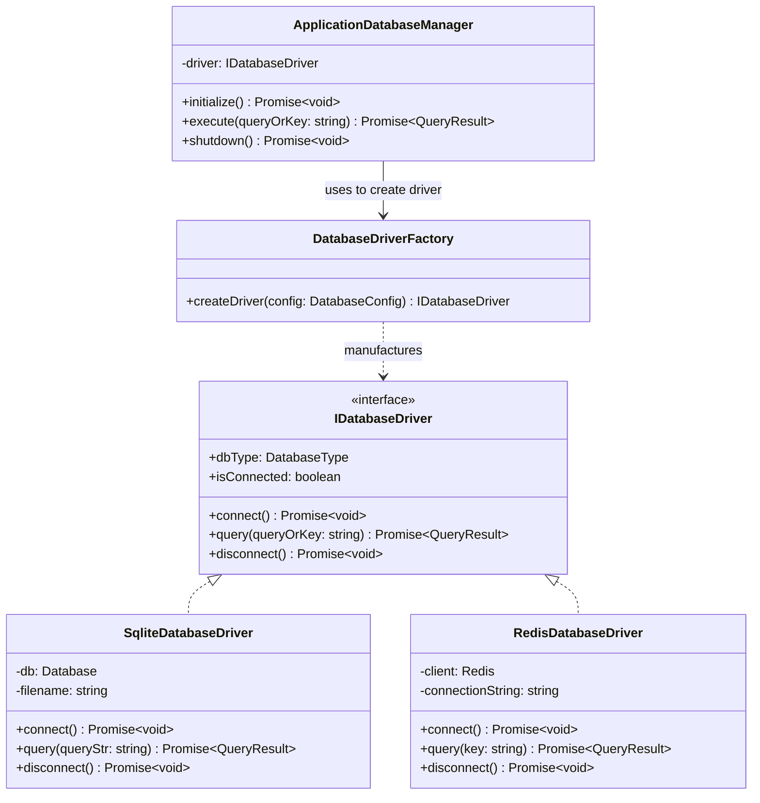

# Production Factory Pattern Guide

## 📌 Pattern Definition

The **Factory Pattern** (specifically the **Factory Method Pattern**) is a creational design pattern that provides an interface for creating objects in a superclass or factory class, while allowing subclasses or factory methods to alter the specific type of objects that will be created.

Rather than calling a constructor directly using the `new` keyword (e.g. `new SqliteDatabaseDriver(...)`), the client delegates object creation to a dedicated **Factory** method (`DatabaseDriverFactory.createDriver(config)`).

---

## 🎯 What Problem Does It Solve?

In enterprise software development, directly instantiating concrete classes inside business logic introduces tight coupling, configuration clutter, and code fragility.

### Without Factory Pattern (Anti-Pattern / Code Smell)

```typescript
// ❌ ANTI-PATTERN: Client code directly instantiates concrete drivers and handles setup
class ApplicationDatabaseManager {
  private driver: any;

  constructor(config: { type: string; filename?: string; uri?: string }) {
    // Tight coupling! Client must know how to construct every single driver
    if (config.type === "sqlite") {
      this.driver = new SqliteDatabaseDriver(config.filename ?? "default.db");
      this.driver.enableWalMode(); // Setup logic leaked into client!
    } else if (config.type === "redis") {
      this.driver = new RedisDatabaseDriver(config.uri ?? "redis://localhost");
      this.driver.configureRetries();
    } else {
      throw new Error("Unknown database type");
    }
  }
}
```

### Key Problems Solved by the Factory Pattern

1. **Decouples Construction from Usage**: The client (`ApplicationDatabaseManager`) depends exclusively on the abstract interface (`IDatabaseDriver`). It has zero knowledge of concrete driver classes (`SqliteDatabaseDriver`, `RedisDatabaseDriver`).
2. **Encapsulates Complex Initialization**: Setting up connection pools, WAL journal modes, SSL keys, or timeout options is hidden entirely inside the Factory.
3. **Adheres to the Open/Closed Principle (OCP)**: Adding support for a new database (e.g., `PostgresDatabaseDriver`) only requires adding a new concrete product class and updating the factory switch case. Zero edits are needed in existing client application code.
4. **Centralizes Object Lifecycles & Configuration Validation**: Validating database connection strings, credentials, or fallback defaults is handled centrally in one place.

---

## 🏗 System Architecture Diagram



---

## 🛠 Core Components Breakdown

| Component | Class / Interface | Role in Architecture |
| :--- | :--- | :--- |
| **Product Interface** | [IDatabaseDriver](file:///Users/sebabratakundu/programming/system-design/LLD/design-patterns/src/factory-pattern/index.ts#L36) | Defines the common contract (`connect`, `query`, `disconnect`, `isConnected`) for all database products. |
| **Concrete Products** | [SqliteDatabaseDriver](file:///Users/sebabratakundu/programming/system-design/LLD/design-patterns/src/factory-pattern/index.ts#L52), [RedisDatabaseDriver](file:///Users/sebabratakundu/programming/system-design/LLD/design-patterns/src/factory-pattern/index.ts#L106) | Implements real production drivers (SQLite using `better-sqlite3`, Redis using `ioredis`). |
| **Factory (Creator)** | [DatabaseDriverFactory](file:///Users/sebabratakundu/programming/system-design/LLD/design-patterns/src/factory-pattern/index.ts#L170) | Contains the static factory method `createDriver(config)`. Manages validation, URI parsing, and instantiation. |
| **Client / Application** | [ApplicationDatabaseManager](file:///Users/sebabratakundu/programming/system-design/LLD/design-patterns/src/factory-pattern/index.ts#L202) | Consumes `IDatabaseDriver` manufactured by `DatabaseDriverFactory` without coupling to concrete classes. |

---

## 💻 Code Example & Usage

```typescript
import { DatabaseDriverFactory, DatabaseConfig } from "./index";

// 1. Define runtime configuration
const config: DatabaseConfig = {
  type: "sqlite",
  filename: "production.db"
};

// 2. Factory manufactures the appropriate concrete driver
const driver = DatabaseDriverFactory.createDriver(config);

// 3. Client uses the manufactured driver interface
await driver.connect();
const result = await driver.query("SELECT * FROM users");
console.log("Query Output:", result);
await driver.disconnect();
```

---

## 🚀 Running the Code

Execute the factory pattern engine using `pnpm`:

```bash
pnpm factory-pattern
```
