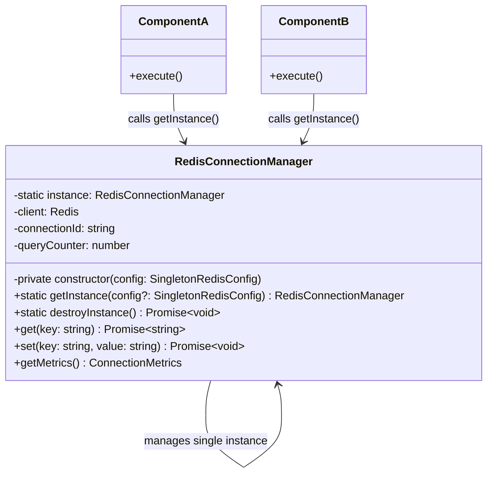

# Production Singleton Pattern Guide

## 📌 Pattern Definition

The **Singleton Pattern** is a creational design pattern that guarantees a class has **only one instance** throughout the lifespan of an application process, while providing a global point of access to that single instance.

Key elements of a proper Singleton:
1. **Private Constructor**: Prevents client code from instantiating the class directly via `new ClassName()`.
2. **Static Instance Field**: Holds the single cached reference to the instance (`private static instance`).
3. **Static Access Method**: Provides global access (`public static getInstance()`), initializing the instance on first access (Lazy Initialization).

---

## 🎯 What Problem Does It Solve?

In high-concurrency enterprise applications, creating multiple instances of resource-heavy objects (such as database connection pools, Redis clients, configuration managers, or telemetry loggers) leads to severe system degradation.

### Without Singleton Pattern (Anti-Pattern / Code Smell)

```typescript
// ❌ ANTI-PATTERN: Every service creates its own connection pool instance
class UserService {
  private redis = new Redis(); // Creates socket connection #1
}

class OrderService {
  private redis = new Redis(); // Creates socket connection #2
}

class PaymentService {
  private redis = new Redis(); // Creates socket connection #3
}
// 💥 Result: Hundreds of duplicate sockets, exhausting OS file descriptors and server RAM!
```

### Key Problems Solved by the Singleton Pattern

1. **Prevents OS Resource & Socket Exhaustion**: Ensures connection pools, database clients, and hardware resources are shared centrally across all microservice modules.
2. **Guarantees Single State Coherency**: Prevents race conditions or inconsistent configurations caused by separate instances operating on conflicting local states.
3. **Lazy Initialization**: Delays heavy object creation and network binding until the exact moment it is first needed, speeding up initial application boot times.
4. **Controlled Global Access**: Encapsulates instance access inside a controlled access method (`getInstance()`) with thread safety and lifecycle telemetry.

---

## 🏗 System Architecture Diagram



---

## 🛠 Core Components Breakdown

| Component | Member | Role in Architecture |
| :--- | :--- | :--- |
| **Private Constructor** | [private constructor(...)](file:///Users/sebabratakundu/programming/system-design/LLD/design-patterns/src/singleton-pattern/index.ts#L49) | Blocks external instantiation (`new RedisConnectionManager()`), forcing callers through `getInstance()`. |
| **Static Instance Field** | [private static instance](file:///Users/sebabratakundu/programming/system-design/LLD/design-patterns/src/singleton-pattern/index.ts#L36) | Stores the single shared instance across the process runtime. |
| **Global Access Method** | [public static getInstance()](file:///Users/sebabratakundu/programming/system-design/LLD/design-patterns/src/singleton-pattern/index.ts#L61) | Checks if `instance` exists; if not, instantiates it lazily and returns the shared reference. |
| **Driver Connection** | [ioredis Driver](file:///Users/sebabratakundu/programming/system-design/LLD/design-patterns/src/singleton-pattern/index.ts#L82) | Manages real production Redis connection pool and socket lifecycle. |

---

## ⚖️ Trade-offs & Best Practices

| Advantages | Considerations / Mitigations |
| :--- | :--- |
| ✅ Strict control over shared resources (Connection Pools, Cache Clients) | ⚠️ **Global State Risk**: Overusing singletons as global variable dumps can hide code dependencies. |
| ✅ Substantial memory & socket footprint reduction | ⚠️ **Unit Testing**: Can make parallel unit testing tricky if state persists across tests. Solve by adding a `destroyInstance()` cleanup method. |
| ✅ Guaranteed reference equality (`instanceA === instanceB`) | ⚠️ **Concurrency**: In multi-threaded environments (e.g. Java/C#), double-checked locking or synchronized blocks are needed. Node.js single-threaded event loop handles instantiation safely. |

---

## 💻 Code Example & Usage

```typescript
import { RedisConnectionManager } from "./index";

// 1. Retrieve instance in Service A
const redisA = RedisConnectionManager.getInstance();
await redisA.set("session:token", "abc123xyz");

// 2. Retrieve instance in Service B
const redisB = RedisConnectionManager.getInstance();
const token = await redisB.get("session:token");

// 3. Both variables reference the exact same memory instance!
console.log(redisA === redisB); // Output: true
```

---

## 🚀 Running the Code

Execute the singleton pattern engine using `pnpm`:

```bash
pnpm singleton-pattern
```
