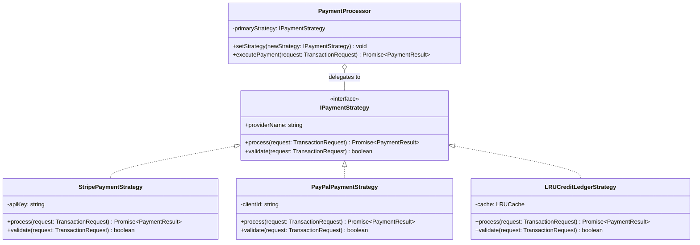

# Production Strategy Pattern Guide

## 📌 Pattern Overview

The **Strategy Pattern** is a behavioral design pattern that converts a family of algorithms or behaviors into separate strategy objects, making them interchangeable inside a client or context object.

### Key Benefits in Production Architecture

1. **Eliminates Rigid `if-else` / `switch` Blocks**: Replaces conditional branching logic with polymorphic strategy invocation.
2. **Runtime Flexibility**: Allows switching strategies dynamically (e.g. failing over from Stripe to PayPal when Stripe is degraded, or using an LRU cache ledger for high-throughput micro-transactions).
3. **Adheres to SOLID Principles**:
   - **Open/Closed Principle (OCP)**: New strategies (e.g., Crypto, Apple Pay) can be added without modifying `PaymentProcessor` or existing strategy classes.
   - **Single Responsibility Principle (SRP)**: Each payment strategy manages its own validation, payload formatting, and API interaction.

---

## 🏗 System Architecture Diagram



---

## 🛠 Core Components Breakdown

| Component | Class / Interface | Role in Architecture |
| :--- | :--- | :--- |
| **Strategy Interface** | [IPaymentStrategy](file:///Users/sebabratakundu/programming/system-design/LLD/design-patterns/src/strategy-pattern/index.ts#L63) | Declares the common contract (`process`, `validate`, `providerName`) for all payment algorithms. |
| **Concrete Strategies** | [StripePaymentStrategy](file:///Users/sebabratakundu/programming/system-design/LLD/design-patterns/src/strategy-pattern/index.ts#L86), [PayPalPaymentStrategy](file:///Users/sebabratakundu/programming/system-design/LLD/design-patterns/src/strategy-pattern/index.ts#L131), [LRUCreditLedgerStrategy](file:///Users/sebabratakundu/programming/system-design/LLD/design-patterns/src/strategy-pattern/index.ts#L169) | Implements specific algorithms (external APIs, in-memory LRU cache ledger using production `lru-cache` driver). |
| **Context Class** | [PaymentProcessor](file:///Users/sebabratakundu/programming/system-design/LLD/design-patterns/src/strategy-pattern/index.ts#L225) | Maintains reference to `IPaymentStrategy`, delegates execution, and supports dynamic runtime strategy mutation (`setStrategy`). |

---

## 🚀 Running the Code

Execute the strategy pattern engine using `pnpm`:

```bash
pnpm start
```
