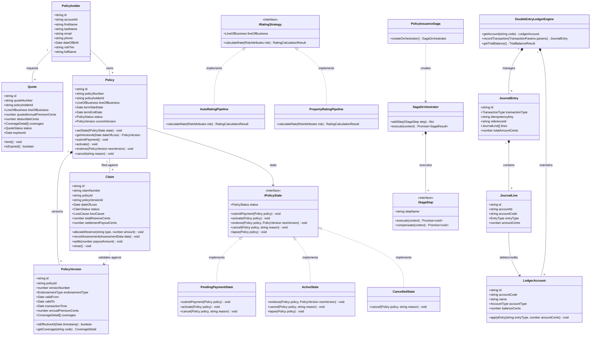

# Insurance Management System (IMS): Low-Level Design (LLD) & Class Diagram Specification

---

## 1. Class Diagram Architecture & Object Relationships

The LLD architecture is organized around Clean Architecture and Domain-Driven Design (DDD), decoupling Domain Models, State Machines, Strategy Pipelines, and Orchestrator Sagas.

### 1.1 Mermaid Class Diagram



---

### 1.2 ASCII Class Hierarchy & Component Map

```
┌──────────────────────────────────────────────────────────────────────────────────────────┐
│                                 DOMAIN ENTITIES (DDD)                                    │
├──────────────────────────────────────────────────────────────────────────────────────────┤
│                                                                                          │
│   ┌──────────────────┐           ┌──────────────────┐                                    │
│   │   Policyholder   │           │      Quote       │                                    │
│   └────────┬─────────┘           └────────┬─────────┘                                    │
│            │ (1:N)                        │ (Generates)                                  │
│            ▼                              ▼                                              │
│   ┌──────────────────────────────────────────────────────────────────┐                   │
│   │                              Policy                              │                   │
│   ├──────────────────────────────────────────────────────────────────┤                   │
│   │ - state: IPolicyState                                            │                   │
│   │ - versions: PolicyVersion[]                                      │                   │
│   │ + getVersionAt(dateOfLoss: Date): PolicyVersion                  │                   │
│   │ + endorse(newVersion: PolicyVersion): void                       │                   │
│   └────────┬─────────────────────────────────────────────────┬───────┘                   │
│            │ (1:N Versions)                                  │ (1:N Claims)              │
│            ▼                                                 ▼                           │
│   ┌──────────────────┐                              ┌──────────────────┐                 │
│   │  PolicyVersion   │ ◄──── (Coverage Validated) ──┤      Claim       │                 │
│   │  [validFrom,     │                              ├──────────────────┤                 │
│   │   validTo)       │                              │ - reserves[]     │                 │
│   └──────────────────┘                              │ - assessment     │                 │
│                                                     └────────┬─────────┘                 │
└──────────────────────────────────────────────────────────────┼───────────────────────────┘
                                                               │ (Posts Reserves/Payouts)
┌──────────────────────────────────────────────────────────────┼───────────────────────────┐
│                           DOUBLE-ENTRY GENERAL LEDGER        ▼                           │
├──────────────────────────────────────────────────────────────────────────────────────────┤
│                                                                                          │
│   ┌──────────────────────────────────────────────────────────────────┐                   │
│   │                      DoubleEntryLedgerEngine                     │                   │
│   ├──────────────────────────────────────────────────────────────────┤                   │
│   │ + recordTransaction(params): JournalEntry                        │                   │
│   │ + getTrialBalance(): { debits, credits, isBalanced }             │                   │
│   └───────────────────────────────┬──────────────────────────────────┘                   │
│                                   │ (Enforces Balance Invariant)                         │
│                                   ▼                                                      │
│                     ┌───────────────────────────┐                                        │
│                     │       JournalEntry        │                                        │
│                     ├───────────────────────────┤                                        │
│                     │ - lines: JournalLine[]    │                                        │
│                     │ (sum Debits == Credits)   │                                        │
│                     └─────────────┬─────────────┘                                        │
│                                   │                                                      │
│                   ┌───────────────┴───────────────┐                                      │
│                   ▼                               ▼                                      │
│         ┌───────────────────┐           ┌───────────────────┐                            │
│         │ JournalLine(Debit)│           │JournalLine(Credit)│                            │
│         └─────────┬─────────┘           └─────────┬─────────┘                            │
│                   │                               │                                      │
│                   ▼                               ▼                                      │
│         ┌───────────────────────────────────────────────────┐                            │
│         │                   LedgerAccount                   │                            │
│         │  (1010-CASH, 2200-UNEARNED, 2100-LOSS-RESERVES)   │                            │
│         └───────────────────────────────────────────────────┘                            │
└──────────────────────────────────────────────────────────────────────────────────────────┘
```

---

## 2. Design Patterns Implemented

### 2.1 State Pattern (`IPolicyState`)
- **Problem**: Policy lifecycle transitions (`Draft` $\to$ `PendingPayment` $\to$ `Active` $\to$ `Endorsed` $\to$ `Cancelled` $\to$ `Lapsed`) must enforce legal rules (e.g. endorsements or claims cannot be processed on a cancelled policy; payments cannot be accepted once cancelled).
- **Implementation**:
  - `IPolicyState` interface defines operations: `submitPayment()`, `activate()`, `endorse()`, `cancel()`, `lapse()`.
  - Concrete classes (`PendingPaymentState`, `ActiveState`, `CancelledState`, `LapsedState`) encapsulate transition guard logic.

### 2.2 Strategy & Pipeline Pattern (`IRatingStrategy`)
- **Problem**: Different lines of business (Auto vs Homeowners) compute premiums with unique risk variables (driver age, accident history vs. flood zones, construction age).
- **Implementation**:
  - `IRatingStrategy` defines a contract for `calculateRate(risk: RiskAttributes)`.
  - `AutoRatingPipeline` and `PropertyRatingPipeline` implement step-by-step risk adjustments, surcharges, and deductible structures.
  - Cached via an in-memory `LRUCache` for $<1\text{ms}$ quoting performance.

### 2.3 Double-Entry Financial Ledger Engine
- **Problem**: Insurance regulations require strict financial traceability across premium receivables, unearned premium reserves, cash collections, and claim loss reserves.
- **Implementation**:
  - `DoubleEntryLedgerEngine` manages the Chart of Accounts (`ASSET`, `LIABILITY`, `EQUITY`, `REVENUE`, `EXPENSE`).
  - `JournalEntry` validates that $\sum \text{Debits} == \sum \text{Credits}$ before any transaction is committed.
  - Generates full Trial Balances ensuring zero discrepancies.

### 2.4 Distributed Saga Orchestrator Pattern
- **Problem**: Coordinating multi-step checkout (`Quote Bind` $\to$ `Draft Policy` $\to$ `Invoice` $\to$ `Payment Gateway` $\to$ `Ledger Booking` $\to$ `Policy Activation`) across services without distributed locks.
- **Implementation**:
  - `SagaOrchestrator<TContext>` runs sequential `ISagaStep` units.
  - If any step fails (e.g. payment failure), it executes compensating reversal steps in **LIFO (Reverse)** order (e.g. issuing automated payment refunds and offsetting ledger entries).

### 2.5 Transactional Outbox & Observer Pattern
- **Problem**: Ensuring reliable, zero-dual-write event publishing to Apache Kafka without distributed 2PC transactions.
- **Implementation**:
  - `TransactionalOutbox` captures `DomainEvent` objects in the same transaction as domain state mutations.
  - Simulates Debezium Change Data Capture (CDC) streaming events (`PolicyIssued`, `PolicyEndorsed`, `ClaimFiled`, `ClaimSettledAndClosed`) to downstream consumer services.

---

## 3. Bi-Temporal Policy Versioning & Claim Coverage Verification

A core domain requirement of insurance systems is evaluating coverage limits for historical losses.

### Coverage Window Formula
$$\text{Covered} \iff \text{validFrom} \le \text{dateOfLoss} < \text{validTo}$$

```typescript
// Policy.ts
public getVersionAt(dateOfLoss: Date): PolicyVersion | undefined {
  return this.versions.find((v) => v.isEffectiveAt(dateOfLoss));
}

// PolicyVersion.ts
public isEffectiveAt(timestamp: Date): boolean {
  const time = timestamp.getTime();
  return time >= this.validFrom.getTime() && time < this.validTo.getTime();
}
```

When an endorsement occurs (e.g. adding a driver or amending coverage limits):
1. `PolicyVersion 1`'s `validTo` is clipped to the endorsement date.
2. `PolicyVersion 2` is created starting from the endorsement date to the policy term end.
3. Claims filed for an incident before the endorsement date automatically resolve to `PolicyVersion 1`; claims after resolve to `PolicyVersion 2`.

---

## 4. End-to-End Simulation Execution

Run the production TypeScript reference implementation:

```bash
cd LLD/insurance-management-system
pnpm install
pnpm dev
```

### Verified Output
```
🏛️  INSURANCE MANAGEMENT SYSTEM (IMS) — LOW-LEVEL DESIGN (LLD) DEMO

▶ STEP 1: Creating Policyholder Profile...
  ✓ Policyholder Created: Alex Mercer (ACC-CBB4ADB3)

▶ STEP 2: Calculating Real-Time Auto Quote with Actuarial Strategy Pipeline...
  ✓ Generated Quote: QTE-47AAD28D ($1460.00 Annual Premium)

▶ STEP 3: Executing Distributed Policy Issuance Saga...
  [SAGA] Executing step: BindQuote...
  [SAGA] Executing step: CreatePolicyDraft...
  [SAGA] Executing step: GenerateInvoice...
  [SAGA] Executing step: CapturePayment...
  [SAGA] Executing step: ActivatePolicy...
  ✓ Policy Successfully Activated! (POL-61E8B74F, Version 1)

▶ STEP 4: Applying Mid-Term Endorsement...
  ✓ Endorsement Stamped to Policy Version 2

▶ STEP 5: Submitting FNOL Claim with Bi-Temporal Verification...
  ✓ Claim Successfully Filed: CLM-5A023354 (Linked to Policy Version 2)
  ✓ Loss Reserve Allocated on Ledger: $6500.00

▶ STEP 6: Adjuster Damage Inspection & Adjudication...
  ✓ Claim Adjudicated: Approved Settlement $5700.00 (after $500 deductible)

▶ STEP 7: Disbursing Claim Settlement Payment on Financial Ledger...
  ✓ Claim Settled & Closed: Disbursed $5700.00

▶ STEP 8: Relaying Transactional Outbox Events via CDC...
  ✓ Total Events Streamed to Kafka: 7

📊 DOUBLE-ENTRY GENERAL LEDGER — FINAL FINANCIAL AUDIT & TRIAL BALANCE
------------------------------------------------------------------------
Account Code             Account Name                    Type        Balance
------------------------------------------------------------------------
1010-CASH                Operating Cash                  ASSET       $-4240.00
1200-AR-PREMIUM          Accounts Receivable (Premiums)  ASSET       $0.00
2100-LOSS-RESERVES       Claim Loss Reserves Payable     LIABILITY   $800.00
2200-UNEARNED-PREMIUM    Unearned Premium Reserve        LIABILITY   $1460.00
4010-EARNED-PREMIUM      Earned Premium Revenue          REVENUE     $0.00
5010-CLAIM-LOSS-EXPENSE  Incurred Claim Loss Expense     EXPENSE     $6500.00
------------------------------------------------------------------------
Trial Balance Check:
  Total Debits:  $2260.00
  Total Credits: $2260.00
  Invariant:     ✅ BALANCED (Zero Discrepancy)
```
