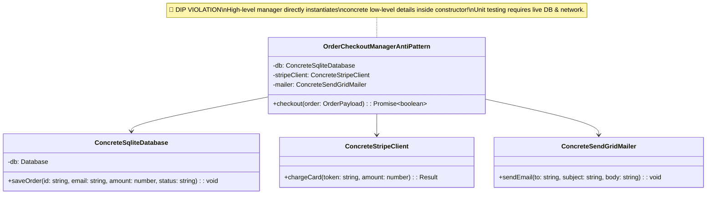

# Dependency Inversion Principle (DIP): The Complete Engineering Guide

---

## 1. The Core Principle: "Depend Upon Abstractions, Not Concretions"

> **"1. High-level modules should not depend on low-level modules. Both should depend on abstractions."**  
> **"2. Abstractions should not depend on details. Details should depend on abstractions."**  
> — *Robert C. Martin ("Uncle Bob"), Agile Software Development*

The **Dependency Inversion Principle (DIP)** is the fifth principle of SOLID design. It establishes the rule that high-level business policy (e.g., checkout workflow, loan processing, order placement) must never depend directly on low-level technical infrastructure details (e.g., SQLite DB queries, Stripe API calls, SMTP email clients).

- **High-Level Policy**: Domain business rules that define what the application does.
- **Low-Level Detail**: Technical implementation mechanisms (databases, UI frameworks, network protocols, third-party SDKs).

```
[ Hardcoded Dependencies Anti-Pattern (Violates DIP) ]

  OrderCheckoutManager (High-Level Policy)
        │
        ├───> new ConcreteSqliteDatabase()  (Low-Level Detail)
        ├───> new ConcreteStripeClient()    (Low-Level Detail)
        └───> new ConcreteSendGridMailer()  (Low-Level Detail)

🔴 Result: High-level business logic is hostage to database & third-party API details!

───────────────────────────────────────────────────────────────────────────────────────

[ Production DIP Architecture (Inversion of Control) ]

  OrderCheckoutService (High-Level Policy)
        │
        ├───> Depends on ───> IOrderRepository   <─── Implemented by ─── SqliteOrderRepository / InMemoryMock
        ├───> Depends on ───> IPaymentGateway   <─── Implemented by ─── StripeGateway / MockGateway
        └───> Depends on ───> IEmailNotifier    <─── Implemented by ─── ResendEmailNotifier / MockNotifier

🟢 Result: Business logic depends ONLY on abstractions. Low-level details conform to business contracts!
```

---

## 2. Code Smells: Spotting DIP Violations

| Code Smell | Description | Root Cause |
| :--- | :--- | :--- |
| **`new` Keywords in Constructors** | Instantiating `new PostgresClient()` or `new StripeSdk()` directly inside business classes | Direct coupling to concrete infrastructure implementations |
| **Impossible Offline Unit Testing** | Running unit tests for business rules requires live DB connections & active API keys | Inability to inject mock or in-memory test doubles |
| **Rigid Framework Lock-in** | Swapping database engines (e.g. SQLite -> PostgreSQL) requires editing core business rules | High-level code coupled to low-level SQL syntax |
| **Cascading Compilation** | Changing low-level HTTP client library requires re-compiling high-level business modules | Reverse dependency direction |

---

## 3. UML Class Diagrams

### 3.1 Anti-Pattern UML Diagram: Hardcoded Dependencies (DIP Violation)



### 3.2 Production DIP Architecture UML Diagram (Clean Inversion of Control)

```mermaid
classDiagram
    class IOrderRepository {
        <<interface>>
        +saveOrder(record: OrderRecord): Promise~void~
    }
    class IPaymentGateway {
        <<interface>>
        +charge(paymentToken: string, amountUsd: number): Promise~Result~
    }
    class IEmailNotifier {
        <<interface>>
        +sendEmail(to: string, subject: string, body: string): Promise~void~
    }

    class SqliteOrderRepository {
        -db: Database
        +saveOrder(record: OrderRecord): Promise~void~
    }
    class InMemoryOrderRepository {
        +savedOrders: Map
        +saveOrder(record: OrderRecord): Promise~void~
    }

    class StripePaymentGateway {
        +charge(paymentToken: string, amountUsd: number): Promise~Result~
    }
    class MockPaymentGateway {
        +charge(paymentToken: string, amountUsd: number): Promise~Result~
    }

    class ResendEmailNotifier {
        +sendEmail(to: string, subject: string, body: string): Promise~void~
    }
    class MockEmailNotifier {
        +sentMessages: Array
        +sendEmail(to: string, subject: string, body: string): Promise~void~
    }

    class OrderCheckoutService {
        -repository: IOrderRepository
        -paymentGateway: IPaymentGateway
        -emailNotifier: IEmailNotifier
        +processCheckout(order: OrderData): Promise~Result~
    }

    IOrderRepository <|.. SqliteOrderRepository
    IOrderRepository <|.. InMemoryOrderRepository

    IPaymentGateway <|.. StripePaymentGateway
    IPaymentGateway <|.. MockPaymentGateway

    IEmailNotifier <|.. ResendEmailNotifier
    IEmailNotifier <|.. MockEmailNotifier

    OrderCheckoutService o-- IOrderRepository
    OrderCheckoutService o-- IPaymentGateway
    OrderCheckoutService o-- IEmailNotifier

    note for OrderCheckoutService "🟢 HIGH-LEVEL POLICY\nDepends strictly on abstractions.\nDependencies injected via constructor!"
    note for InMemoryOrderRepository "🟢 LIGHTNING UNIT TESTS\nSubstituted in unit tests for 1ms execution\nwith zero DB/network I/O side effects!"
```



---

## 4. Architectural Comparison Table

```
+---------------------------------------------------------------------------------------------------+
|                                Anti-Pattern vs. Production DIP                                    |
+---------------------+---------------------------------------+-------------------------------------+
| Dimension           | Hardcoded Dependencies Anti-Pattern   | Production DIP Architecture         |
+---------------------+---------------------------------------+-------------------------------------+
| Dependency Flow     | High-level policy -> Low-level detail | High & Low level -> Abstractions    |
| Inversion of Control| ❌ NO (Module controls instantiations)| ✅ YES (Injected via Constructor DI)|
| Unit Testability    | Slow & Fragile (Needs real DB & APIs) | Lightning Fast (1ms in-memory mocks)|
| Infrastructure Swap | Rigid (Editing business logic required)| Flexible (Swap driver in 1 line)    |
| Code Coupling       | Tight (Coupled to vendor SDKs & SQL)  | Loose (Coupled strictly to interfaces)|
+---------------------+---------------------------------------+-------------------------------------+
```

---

## 5. How to Run the Codebase Example

Execute the interactive benchmark and architectural comparison:

```bash
cd LLD/solid/dependency-inversion-principle
pnpm start
```
