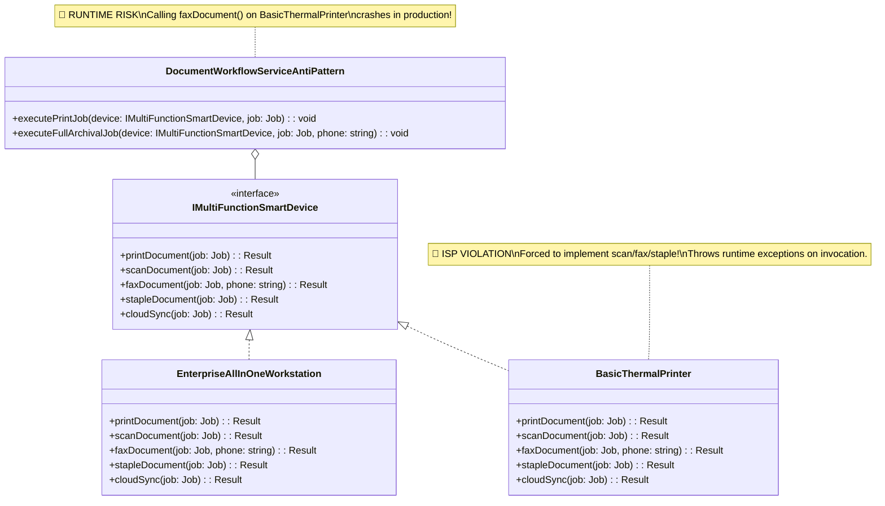
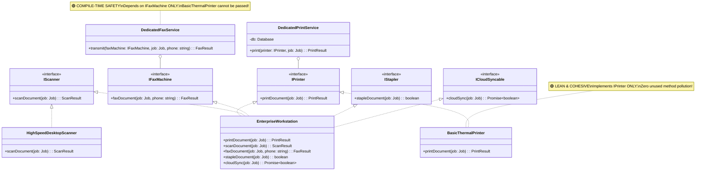

# Interface Segregation Principle (ISP): The Complete Engineering Guide

---

## 1. The Core Principle: "Clients Should Not Depend on Methods They Don't Use"

> **"Clients should not be forced to depend upon interfaces that they do not use."**  
> — *Robert C. Martin ("Uncle Bob"), Clean Architecture*

The **Interface Segregation Principle (ISP)** is the fourth principle of SOLID design. ISP focuses on breaking down large, monolithic ("fat") interfaces into small, specific **Role Interfaces** tailored to individual client needs.

- **Fat / Bloated Interface**: A single interface containing methods for multiple unrelated domains or capabilities (e.g., printing, scanning, faxing, stapling, cloud backup).
- **Role Interface**: A lean, cohesive interface containing only the methods required for a specific role or client (e.g., `IPrinter` containing only `printDocument()`).

```
[ Fat Interface Anti-Pattern (Violates ISP) ]

  BasicThermalPrinter ───> Implements ───> IMultiFunctionSmartDevice
                                                ├── printDocument() ✅
                                                ├── scanDocument() 🔴 (Throws Exception!)
                                                ├── faxDocument()  🔴 (Throws Exception!)
                                                └── cloudSync()    🔴 (Throws Exception!)

───────────────────────────────────────────────────────────────────────────────────────

[ Production ISP Architecture (Role Interfaces) ]

  BasicThermalPrinter ───────────> Implements ───> IPrinter (printDocument ONLY)

  EnterpriseWorkstation ────────> Implements ───> IPrinter, IScanner, IFaxMachine, ICloudSyncable
```

---

## 2. Code Smells: Spotting ISP Violations

| Code Smell | Description | Root Cause |
| :--- | :--- | :--- |
| **Fat / Header Interface** | Interfaces with 10+ methods spanning multiple unrelated business domains | Bundling all system features into one global contract |
| **Throwing "Not Implemented" Errors** | Classes overriding interface methods only to throw `Error("Not Supported")` | Forced implementation of irrelevant methods |
| **Empty Dummy Method Overrides** | Classes implementing methods with empty body `{}` to satisfy the compiler | Polluting classes with unused interface methods |
| **Re-compilation Cascades** | Modifying a fax method signature forces re-building simple printing modules | Tight coupling to unneeded interface methods |

---

## 3. UML Class Diagrams

### 3.1 Anti-Pattern UML Diagram: Bloated Fat Interface (ISP Violation)



### 3.2 Production ISP Architecture UML Diagram (Role Interfaces)



---

## 4. Architectural Comparison Table

```
+---------------------------------------------------------------------------------------------------+
|                                Anti-Pattern vs. Production ISP                                    |
+---------------------+---------------------------------------+-------------------------------------+
| Dimension           | Fat Interface Anti-Pattern            | Production ISP Architecture         |
+---------------------+---------------------------------------+-------------------------------------+
| Interface Design    | Monolithic (15+ methods)              | Role Interfaces (Single Capability) |
| Unused Method Burden| High (Forced exceptions / dummy code) | Zero (Classes implement what works) |
| Compile-Time Safety | Low (Invalid method calls crash app)  | High (Compiler rejects invalid call)|
| Re-compilation Risk | High (Cascades across unrelated code) | Zero (Changes isolated to role)     |
| Client Coupling     | Tight (Coupled to entire fat monolith)| Loose (Coupled to narrow role spec) |
+---------------------+---------------------------------------+-------------------------------------+
```

---

## 5. How to Run the Codebase Example

Execute the interactive benchmark and architectural comparison:

```bash
cd LLD/solid/interface-segregation-principle
pnpm start
```
