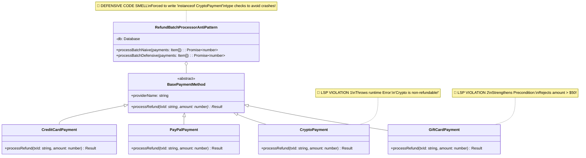
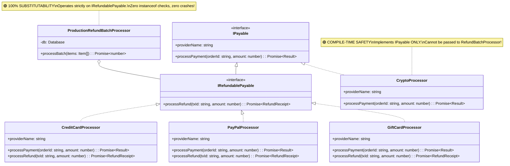

# Liskov Substitution Principle (LSP): The Complete Engineering Guide

---

## 1. The Core Principle: "Behavioral Substitutability"

> **"Let $\phi(x)$ be a property provable about objects $x$ of type $T$. Then $\phi(y)$ should be true for objects $y$ of type $S$ where $S$ is a subtype of $T$."**  
> — *Barbara Liskov & Jeannette Wing (1994)*

The **Liskov Substitution Principle (LSP)** is the third principle of SOLID design. In software engineering terms, LSP dictates that **subclasses or derived types must be completely substitutable for their base types without breaking client expectations, throwing unexpected exceptions, or modifying program correctness**.

- **Syntactic Substitutability**: The subtype matches the method signatures of the base type (enforced by compilers).
- **Behavioral Substitutability**: The subtype matches the expected *behavior*, contracts, preconditions, and postconditions of the base type (enforced by software design).

```
[ Monolithic LSP Violation (Broken Substitutability) ]

  Client Code ───> Expects BasePaymentMethod.processRefund()
                         │
                         ├─> CreditCardPayment ──> ✅ Refunds successfully
                         │
                         └─> CryptoPayment ─────> 🔴 THROWS UNEXPECTED RUNTIME EXCEPTION!
                                                  ("Crypto is non-refundable!")

───────────────────────────────────────────────────────────────────────────────────────

[ Production LSP Architecture (Role Interface Segregation) ]

  Client Code (Refunds) ───> Expects IRefundablePayable
                                   │
                                   ├─> CreditCardProcessor ──> ✅ Refunds successfully
                                   └─> PayPalProcessor ──────> ✅ Refunds successfully

  Client Code (Payments) ───> Expects IPayable
                                   └─> CryptoProcessor ──────> ✅ Processes payment (No refund method)
```

---

## 2. The 6 Formal Rules of Liskov Substitution

To guarantee behavioral subtyping, subtypes must adhere to 6 formal rules:

| Rule | Description | Violation Example |
| :--- | :--- | :--- |
| **1. Contravariance of Arguments** | Subtype method arguments must be equal or broader than supertype arguments | Subtype requiring stricter argument types |
| **2. Covariance of Return Types** | Subtype method return type must be equal or a narrower subtype of supertype return type | Subtype returning `null` when supertype guarantees non-null object |
| **3. Preconditions Cannot be Strengthened** | Subtype cannot demand stricter conditions for inputs than base class | Base class allows any amount, subtype rejects amount > $50 |
| **4. Postconditions Cannot be Weakened** | Subtype must guarantee at least as much outcome as base class | Base class guarantees DB record creation, subtype skips DB write |
| **5. Invariants Must be Preserved** | Subtype must maintain all state invariants of base class | Subtype modifying private base invariant field unexpectedly |
| **6. History Constraint** | Subtype cannot allow state changes that supertype prohibits | Subtype allowing modification of an immutable base object |

---

## 3. Code Smells: Spotting LSP Violations

1. **Throwing `NotImplementedException` or Unsupported Errors**: A subclass overriding a base method only to throw `new Error("Not Supported")`.
2. **Defensive `instanceof` / Type Checking in Clients**: Writing `if (obj instanceof SubClass)` in client code because polymorphism cannot be trusted.
3. **Empty Overridden Methods**: Overriding a base method with `{ /* do nothing */ }` to suppress base functionality.
4. **Strengthened Preconditions**: Subclass rejecting inputs that the base class documents as valid.

---

## 4. UML Class Diagrams

### 4.1 Anti-Pattern UML Diagram: Broken Substitutability (LSP Violation)



### 4.2 Production LSP Architecture UML Diagram (Interface Segregation & Behavioral Subtyping)



---

## 5. Architectural Comparison Table

```
+---------------------------------------------------------------------------------------------------+
|                                Anti-Pattern vs. Production LSP                                    |
+---------------------+---------------------------------------+-------------------------------------+
| Dimension           | LSP Violation Anti-Pattern            | Production LSP Architecture         |
+---------------------+---------------------------------------+-------------------------------------+
| Behavioral Contract | ❌ Subclass throws unexpected error   | ✅ Subtypes 100% fulfill contract   |
| Precondition Rules  | ❌ Strengthened in subclass (> $50)   | ✅ Preserved without extra limits   |
| Client Code Checks  | ❌ Forced `instanceof` type checking  | ✅ Pure polymorphism, zero checks   |
| Type System Safety  | ❌ Runtime crashes during execution   | ✅ Compile-time capability checks   |
| Interface Hierarchy | Monolithic superclass forced on all   | Role Interface Segregation          |
+---------------------+---------------------------------------+-------------------------------------+
```

---

## 6. How to Run the Codebase Example

Execute the interactive benchmark and architectural comparison:

```bash
cd LLD/solid/liskov-substitution-principle
pnpm start
```
