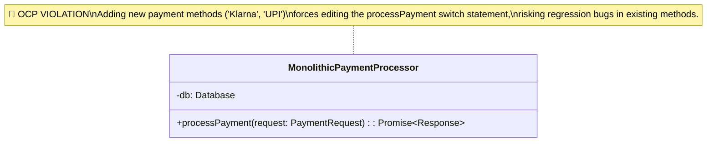
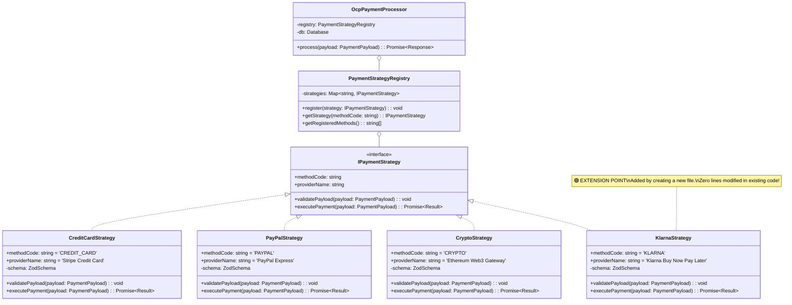

# Open-Closed Principle (OCP): The Complete Engineering Guide

---

## 1. The Core Principle: "Open for Extension, Closed for Modification"

> **"Software entities (classes, modules, functions, etc.) should be open for extension, but closed for modification."**  
> — *Bertrand Meyer / Robert C. Martin ("Uncle Bob")*

The **Open-Closed Principle (OCP)** is the second principle of SOLID design. It establishes the rule that software systems should allow new behaviors or features to be added **without modifying existing, tested, and deployed source code**.

- **Open for Extension**: The behavior of a module can be extended to support new business requirements or new features.
- **Closed for Modification**: Extending module behavior does **not** require modifying existing source code, eliminating regression risks in production.

```
[ Monolithic Switch Anti-Pattern (Violates OCP) ]

  Adding "Klarna" ───> MUST MODIFY ───> PaymentProcessor.ts (Switch Statement)
                                              │
                                              └───> Risks breaking CreditCard & PayPal logic!

───────────────────────────────────────────────────────────────────────────────────────

[ Production OCP Strategy Architecture (Adheres to OCP) ]

  Adding "Klarna" ───> CREATE NEW FILE ───> KlarnaStrategy.ts (Implements IPaymentStrategy)
                                                    │
                                                    └───> Zero lines modified in existing code!
```

---

## 2. Code Smells: Spotting OCP Violations

| Code Smell | Description | Root Cause |
| :--- | :--- | :--- |
| **Monolithic Switch/If-Else Cascades** | Giant `switch(type)` statements checking string codes or enums | Hardcoded conditional branch execution |
| **High Regression Testing Risk** | Adding a 5th payment method requires re-running full test suites for methods 1-4 | Modifying core processor file for every new feature |
| **Type-Checking Duplication** | Checking `if (user.type === 'PREMIUM')` in 10 different files | Missing polymorphism and strategy abstraction |
| **Fragile Deployments** | Minor feature additions break unrelated production flows | Modifying existing tested source code |

---

## 3. Design Patterns Supporting OCP

1. **Strategy Pattern**: Encapsulates algorithms or business rules into interchangeable strategy classes implementing a shared interface contract.
2. **Plugin Registry Pattern**: Maintains a registry of active strategy plugins, allowing dynamic strategy registration at runtime or bootstrap.
3. **Factory Method Pattern**: Instantiates strategy implementations dynamically based on context without hardcoding concrete classes.
4. **Decorator Pattern**: Extends component behavior dynamically by wrapping instances rather than modifying internal class logic.

---

## 4. Production OCP Architecture Diagram

```
[ Production OCP Clean Architecture ]

                          ┌──────────────────────────────┐
                          │     OcpPaymentProcessor      │
                          └──────────────┬───────────────┘
                                         │ Delegates Execution
                                         ▼
                          ┌──────────────────────────────┐
                          │   PaymentStrategyRegistry    │
                          └──────────────┬───────────────┘
                                         │ Plugin Registry
          ┌──────────────┬───────────────┼───────────────┬──────────────┐
          ▼              ▼               ▼               ▼              ▼
   ┌─────────────┐┌──────────────┐┌─────────────┐┌─────────────┐┌──────────────┐
   │ CreditCard  ││   PayPal     ││   Crypto    ││  ApplePay   ││   Klarna     │
   │  Strategy   ││  Strategy    ││  Strategy   ││  Strategy   ││  Strategy   │
   └─────────────┘└──────────────┘└─────────────┘└─────────────┘└──────────────┘
    Stripe CC       PayPal Express Web3 Gateway   Apple Direct    BNPL Credit
    (Existing)      (Existing)     (Existing)     (Existing)      (NEW Feature!)
```

---

## 5. Component Breakdown

| Component Name | Single Responsibility | OCP Extension Role | Production Tech Stack |
| :--- | :--- | :--- | :--- |
| `IPaymentStrategy` | Contract for all payment execution engines | Abstraction Interface | TypeScript Interface |
| `CreditCardStrategy` | Encapsulates credit card API logic | Concrete Strategy 1 | `zod` + Stripe API |
| `PayPalStrategy` | Encapsulates PayPal OAuth checkout | Concrete Strategy 2 | `zod` + PayPal API |
| `CryptoStrategy` | Encapsulates Web3 wallet verification | Concrete Strategy 3 | `zod` + Web3 Gateway |
| `KlarnaStrategy` | Encapsulates BNPL installment plans | **NEW Feature Extension** | `zod` + Klarna API |
| `PaymentStrategyRegistry` | Strategy lookup & dynamic registration | Plugin Registry | `Map<string, Strategy>` |
| `OcpPaymentProcessor` | Payment execution coordinator | Closed Core Processor | `better-sqlite3` |

---

## 6. UML Class Diagrams

### 6.1 Anti-Pattern UML Diagram: Monolithic Switch Cascade (OCP Violation)



### 6.2 Production OCP Architecture UML Diagram (Clean SOLID Strategy Pattern)



---

## 7. Architectural Comparison Table

```
+---------------------------------------------------------------------------------------------------+
|                                Anti-Pattern vs. Production OCP                                    |
+---------------------+---------------------------------------+-------------------------------------+
| Dimension           | Monolithic Switch Cascade Anti-Pattern| Production OCP Strategy Architecture|
+---------------------+---------------------------------------+-------------------------------------+
| Adding New Feature  | Requires editing existing file        | Purely additive: Create 1 new class |
| Closed for Mod      | ❌ NO (Core logic edited constantly)  | ✅ YES (Core code never modified)   |
| Risk of Regression  | High (Side effects on existing types) | Zero (Existing files untouched)     |
| Code Cohesion       | Low (All provider logic in 1 method)  | High (Vendor logic isolated in class|
| Unit Testability    | Must test entire 400-line processor   | Test single strategy in isolation   |
| Maintainability     | Decreases as system grows             | Constant O(1) maintainability       |
+---------------------+---------------------------------------+-------------------------------------+
```

---

## 8. How to Run the Codebase Example

Execute the interactive benchmark and architectural comparison:

```bash
cd LLD/solid/open-closed-principle
pnpm start
```
