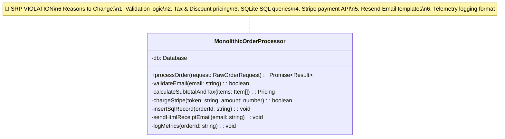

# Single Responsibility Principle (SRP): The Complete Engineering Guide

---

## 1. The Core Principle: "One Reason to Change"

> **"A module or class should have one, and only one, reason to change."**  
> — *Robert C. Martin ("Uncle Bob"), Clean Code*

The **Single Responsibility Principle (SRP)** is the first principle of the SOLID design guidelines. A common misconception is that SRP means *"a class should do only one thing"*. While doing one thing is a good design goal, the formal architectural definition of SRP centers on **actor cohesion and reasons to change**:

- A **"Reason to Change"** is tied directly to a specific stakeholder, department, or external system requirement (e.g., Finance department changing tax rules vs. Security team changing password hashing algorithms).
- If a single class gathers responsibilities owned by different actors, changing logic for one actor risks breaking functionality relied upon by another.

```
[ Monolithic God Class (Multiple Reasons to Change) ]

                       ┌─────────────────────────────────────┐
  Finance Team ───────>│                                     │
                       │     MonolithicOrderProcessor        │
  Security Team ──────>│                                     │<────── DBA / Data Team
                       │  (Validation, Pricing, Database,    │
  Marketing Team ─────>│   Stripe API, Email, Metrics)       │<────── DevOps Team
                       └─────────────────────────────────────┘
                       
🔴 Result: High coupling, frequent merge conflicts, fragility, difficult unit testing!
```

---

## 2. Code Smells: Spotting SRP Violations

| Code Smell | Description | Root Cause |
| :--- | :--- | :--- |
| **God Class / Monster Method** | A class with 500+ lines handling DB, HTTP calls, validation, and HTML rendering | Accumulating unrelated concerns into a single file |
| **Shotgun Surgery** | Modifying a single feature requires editing 10 different unrelated files | Responsibilities scattered across multiple places |
| **Divergent Change** | Editing one file for 5 completely different business reasons | Single file holding multiple responsibilities |
| **Fragile Unit Tests** | Writing a unit test for discount calculation requires initializing SQLite database & mock HTTP servers | Hardcoded dependencies and mixed IO concerns |

---

## 3. Production Architecture: Decoupled SRP Components

In production systems, decouple monolithic workflows into focused, single-purpose classes coordinated by a high-level orchestrator:

```
[ Production SRP Clean Architecture ]

                          ┌──────────────────────────────┐
                          │  OrderCheckoutOrchestrator   │
                          └──────────────┬───────────────┘
                                         │ Coordinates
          ┌──────────────┬───────────────┼───────────────┬──────────────┐
          ▼              ▼               ▼               ▼              ▼
   ┌─────────────┐┌──────────────┐┌─────────────┐┌─────────────┐┌──────────────┐
   │    Order    ││   Tax &      ││ SqlOrder    ││ Stripe      ││ Resend       │
   │  Validator  ││  Discount    ││ Repository  ││ Payment     ││ Notifier     │
   │   (Zod)     ││ Calculator   ││ (SQLite DB) ││ Processor   ││ Notifier     │
   └─────────────┘└──────────────┘└─────────────┘└─────────────┘└──────────────┘
    Validation      Pricing &       Persistence     External      Notification
     Schema          Taxes            Driver        Payment          Delivery
```

### Component Responsibility Breakdown

| Class Name | Single Responsibility | Reason to Change | Real Production Driver |
| :--- | :--- | :--- | :--- |
| `OrderValidator` | Schema parsing & data contract validation | Input validation rules change | `zod` |
| `TaxAndDiscountCalculator` | Financial pricing, taxes, and discounts | Tax policy or promo code rules change | Domain logic |
| `SqlOrderRepository` | Data persistence & transaction execution | DB schema or SQL queries change | `better-sqlite3` |
| `StripePaymentProcessor` | Payment gateway API integration | Payment provider API changes | Stripe API client |
| `ResendEmailNotifier` | Transactional notification delivery | Receipt formatting or email vendor changes | Resend / SendGrid |
| `MetricsTelemetryLogger` | Application metrics & audit logging | Telemetry / APM metric formats change | Datadog / OpenTelemetry |
| `OrderCheckoutOrchestrator` | Coordinating high-level execution flow | High-level checkout process flow changes | Dependency Injection |

---

## 4. UML Class Diagrams

### 4.1 Anti-Pattern UML Diagram: Monolithic God Class (SRP Violation)



### 4.2 Production SRP Architecture UML Diagram (Clean SOLID)

```mermaid
classDiagram
    class IOrderValidator {
        <<interface>>
        +validate(request: CheckoutRequest): CheckoutRequest
    }
    class ITaxAndDiscountCalculator {
        <<interface>>
        +calculatePricing(items: Item[], promoCode?: string): PricingBreakdown
    }
    class IOrderRepository {
        <<interface>>
        +saveOrder(record: OrderRecord): Promise~void~
    }
    class IPaymentProcessor {
        <<interface>>
        +processPayment(token: string, amount: number): Promise~Result~
    }
    class INotificationService {
        <<interface>>
        +sendReceipt(email: string, orderId: string, total: number): Promise~void~
    }
    class ITelemetryLogger {
        <<interface>>
        +logOrderSuccess(orderId: string, amount: number, duration: number): void
        +logOrderFailure(orderId: string, error: string): void
    }

    class OrderValidator {
        -schema: ZodSchema
        +validate(request: CheckoutRequest): CheckoutRequest
    }
    class TaxAndDiscountCalculator {
        -defaultTaxRate: number
        +calculatePricing(items: Item[], promoCode?: string): PricingBreakdown
    }
    class SqlOrderRepository {
        -db: Database
        +saveOrder(record: OrderRecord): Promise~void~
    }
    class StripePaymentProcessor {
        +processPayment(token: string, amount: number): Promise~Result~
    }
    class ResendEmailNotifier {
        +sendReceipt(email: string, orderId: string, total: number): Promise~void~
    }
    class MetricsTelemetryLogger {
        +logOrderSuccess(orderId: string, amount: number, duration: number): void
        +logOrderFailure(orderId: string, error: string): void
    }

    class OrderCheckoutOrchestrator {
        -validator: IOrderValidator
        -pricingCalculator: ITaxAndDiscountCalculator
        -orderRepository: IOrderRepository
        -paymentProcessor: IPaymentProcessor
        -notificationService: INotificationService
        -telemetryLogger: ITelemetryLogger
        +checkout(request: CheckoutRequest): Promise~Result~
    }

    IOrderValidator <|.. OrderValidator
    ITaxAndDiscountCalculator <|.. TaxAndDiscountCalculator
    IOrderRepository <|.. SqlOrderRepository
    IPaymentProcessor <|.. StripePaymentProcessor
    INotificationService <|.. ResendEmailNotifier
    ITelemetryLogger <|.. MetricsTelemetryLogger

    OrderCheckoutOrchestrator o-- IOrderValidator
    OrderCheckoutOrchestrator o-- ITaxAndDiscountCalculator
    OrderCheckoutOrchestrator o-- IOrderRepository
    OrderCheckoutOrchestrator o-- IPaymentProcessor
    OrderCheckoutOrchestrator o-- INotificationService
    OrderCheckoutOrchestrator o-- ITelemetryLogger
```



---

## 5. Architectural Comparison Table

```
+---------------------------------------------------------------------------------------------------+
|                                Anti-Pattern vs. Production SRP                                    |
+---------------------+---------------------------------------+-------------------------------------+
| Dimension           | Monolithic God Class Anti-Pattern     | Production SRP Architecture         |
+---------------------+---------------------------------------+-------------------------------------+
| Reasons to Change   | 6+ (Validation, Tax, DB, Payment, etc)| 1 per class (Strictly isolated)     |
| Cohesion            | Low (Mixed domain & I/O concerns)     | High (Focused, single purpose)      |
| Coupling            | Tight (Hardcoded concrete drivers)    | Loose (Interface abstractions / DI) |
| Unit Testability    | Difficult (Heavy DB/network setup)    | Extremely Easy (Isolated mocks)     |
| Risk of Regression  | High (Side effects across domains)    | Zero (Changes isolated to 1 module) |
| Readability         | Low (Giant monolithic methods)        | High (Small, declarative methods)   |
+---------------------+---------------------------------------+-------------------------------------+
```

---

## 6. How to Run the Codebase Example

Execute the interactive benchmark and architectural comparison:

```bash
cd LLD/solid/single-responsibility-principle
pnpm start
```
